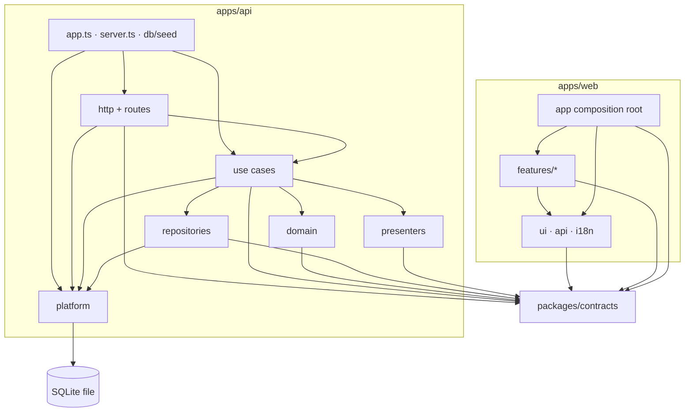
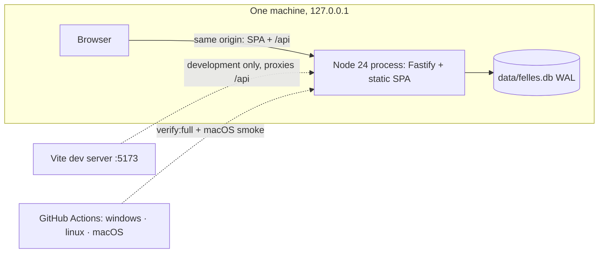
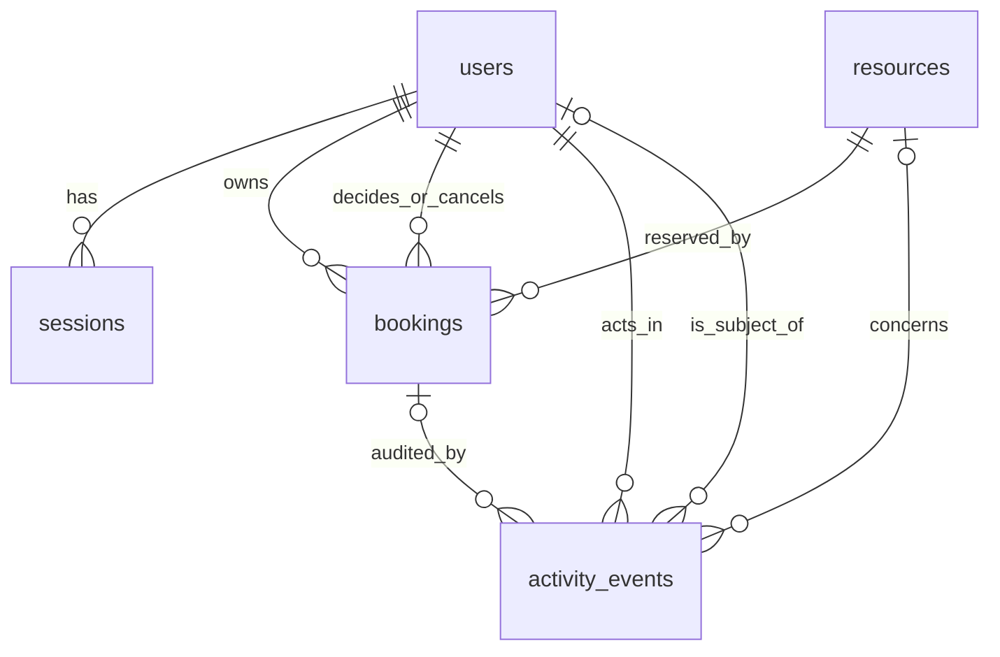

# Architecture Spine — FELLES

## Design Paradigm

**Contract-first modular monolith.** One repository, three npm workspaces, one deployable process. `packages/contracts` is the shared kernel: every wire shape, route, error code and pure shared rule is defined there once. The API is layered (adapters → use cases → pure domain, repositories behind use cases). The web is organised by feature under a composition root (`app/`), with TanStack Query as the only holder of server state.

| Layer | Where | Role |
| --- | --- | --- |
| Contracts | `packages/contracts` | Zod schemas, DTO types, route table, error codes, Norwegian messages, pure rules |
| Adapters | `apps/api/src/http`, `modules/*/routes.ts` | Fastify wiring, guards, envelope mapping; no business rules |
| Use cases | `apps/api/src/modules/*` use-case files | One transaction script per mutation or read; authorisation and orchestration |
| Domain | `apps/api/src/modules/*/domain` | Pure functions: state machine, policy; no I/O |
| Repositories | `apps/api/src/modules/*/*.repository.ts` | The only code that names tables or writes SQL |
| Platform | `apps/api/src/platform` | db, unit of work, clock, Oslo time (the only Temporal import), logger, password, tokens, AppError |
| Web composition root | `apps/web/src/app` | Router, shell, providers for the `api/` hooks; the only place that imports feature pages |
| Web features | `apps/web/src/features/*` | Pages and feature components, one folder per slice-owned feature |
| Web kit | `apps/web/src/ui`, `api`, `i18n` | Tokens, primitives, API client, query keys, strings, formatting |



Arrows are the only permitted import directions. `contracts` imports nothing from the apps. `web` never imports `api` and the reverse. Features never import other features or `app/`. Everything a feature needs from the shell lives in `apps/web/src/api/` (`useSession()`, `useNow()` in `api/clock.ts`, `links.ts` URL helpers, `useBookingSheet()` in `api/sheet.ts`, slot hooks in `api/slots.ts`); `app/` supplies their implementations through providers at the composition root. `app.ts`, `server.ts` and `db/seed` are the API composition root and may import every API layer except the internals of `modules/*/routes.ts`.

## Invariants & Rules

### AD-1 — Layering and module boundaries

- **Binds:** all API and web code
- **Prevents:** business rules in routes or components; modules reaching into each other's SQL
- **Rule:** Imports follow the diagram. API modules (`auth`, `resources`, `bookings`, `activity`, `dashboard`) call each other only through the other module's `index.ts`. `domain` imports neither `fastify` nor `better-sqlite3`. SQL appears only in `*.repository.ts`, `platform/db`, migrations and seed. Only the `bookings` module names the `bookings` table and only the `activity` module names `activity_events` (table-name lint rule per directory; its allowlist is exactly `apps/api/db/migrations`, `apps/api/db/seed` and `apps/api/test`). Other modules use `bookings/index.ts` (`countFutureBlocking`, `BookingsReadPort`, `presentBooking`) and `activity/index.ts` (`recordEvent`, `listEventsForBooking`); the dependency is one-way, `bookings → activity`, never the reverse. ESLint `no-restricted-imports` overrides (core rule) enforce the diagram; a violation fails `npm run lint`.

### AD-2 — Contracts are the single source for the wire

- **Binds:** RUN-1, BR-4, DEC-14, DEC-16; every route and DTO
- **Prevents:** two agents inventing different shapes; client and server validation texts diverging; unbounded input
- **Rule:** `packages/contracts` exports Zod schemas with inferred DTO types, the route table, status enums, the error-code enum with a Norwegian message catalogue (count-bearing messages are functions of `details`), the fixed symbol and colour lists, and the pure shared rules (AD-5, AD-16, `normaliseEmail`, `normaliseSearch`, `compareNb`, the slot model `availability.ts`). It has no I/O, no environment access and no imports from `apps/*`. One file per module (`session`, `resources`, `bookings`, `activity`, `dashboard`) plus `errors`, `time`, `rules`, `availability`, `routes`, `index`; the barrel is created in S00 and re-exports all. Request schemas are `.strict()`; server-owned fields (`userId`, `status`, `role`, timestamps) exist in no request schema. Strings are trimmed and NFC-normalised, `""` becomes `null` for optional text (on `PATCH` an omitted key is unchanged and `null` clears an optional value), control and bidi characters are rejected, and every string has a maximum (email 254, name 80, description 500, purpose 200, reason 200). A Zod error map built from the catalogue is installed on both sides; field-error `path` equals the form field name (`resourceId`, `date`, `start`, `end`, `purpose`, `reason`). The API parses requests with these schemas; the web parses every response. The symbol and colour lists must equal `DESIGN.md` (checked by AD-22's tokens check).

### AD-3 — Routes are declared, not improvised

- **Binds:** AUT-02, AUT-03, BR-6, NFR-04, E2E-07
- **Prevents:** an unguarded route; a handler bypassing validation, access or the envelope; a stub left in a release
- **Rule:** Each route is an entry in the contract table: `method`, `path`, `access` (`public` | `authenticated` | `admin`), params/query/body/response schemas and its error codes. Handlers are registered only through `registerRoute(contract, handler)`, which checks access first (default deny), parses input, and maps results and `AppError` to the envelope. Unimplemented routes are registered by the same helper with a `NOT_IMPLEMENTED` stub (501), so access is checked before the stub answers. The app refuses to start if a contracted route has no handler or a handler is registered outside the table. A route-enumeration test walks the table: 401 without a session on every non-public route, 403 for a Member on every `admin` route, 403 for a Member on every foreign-booking action, and (gated into the S07 integration job) no route answers 501.

### AD-4 — Error envelope and status mapping (DEC-16, confirmed with extensions)

- **Binds:** BR-4, BOK-07, APP-03, UI-4; every mutation
- **Prevents:** per-slice error shapes; the UI parsing messages instead of codes
- **Rule:** Every non-2xx response, including framework and unknown-route errors, is `{ "error": { "code", "message", "fieldErrors"?, "details"? } }`. `code` is English `SCREAMING_SNAKE`; `message` is user-facing Norwegian bokmål; `fieldErrors` is an array of `{ path, code, message }`; `details` is typed per code. Mapping: 400 `VALIDATION_FAILED`; 401 `UNAUTHENTICATED` (no or expired session) and `INVALID_CREDENTIALS` (the 5th consecutive failure adds `details.retryAfterSeconds`); 403 `FORBIDDEN`, `OWN_REQUEST`, `ORIGIN_REFUSED`; 404 `NOT_FOUND`; 409 `BOOKING_CONFLICT` (empty details), `BOOKING_NOT_PENDING` (approve, reject), `BOOKING_NOT_CANCELLABLE` (cancel on a terminal status), `BOOKING_STARTED` (approve or cancel at or after start), `RESOURCE_ARCHIVED`, `RESOURCE_HAS_FUTURE_BOOKINGS` (`futureBookingCount`, `firstFutureBookingAt`), `BOOKING_NOT_PENDING`, `BOOKING_NOT_CANCELLABLE` and `BOOKING_STARTED` carry `details.currentStatus`, `RESOURCE_ARCHIVED` has empty details; 421 `HOST_REFUSED`; 429 `RATE_LIMITED` (`retryAfterSeconds`); 500 `INTERNAL`; 501 `NOT_IMPLEMENTED`; 503 `DATABASE_BUSY`. Only use cases throw `AppError`; one handler formats everything; malformed JSON, 413 and 415 map to 400 `VALIDATION_FAILED`, an unknown path or method to 404 `NOT_FOUND`; parser and SQLite messages never reach a response. Statuses 421, 429, 500, 501 and 503 extend DEC-16 (needs Jo). Lists follow AD-16.

### AD-5 — Time model

- **Binds:** BR-1, BOK-02, DEC-08, DEC-09, UI-5
- **Prevents:** client and server disagreeing across DST; mixed date formats; local-time bugs
- **Rule:** The database stores instants as `INTEGER` epoch milliseconds UTC; the wire carries ISO 8601 UTC with milliseconds and `Z`. A booking request carries Oslo civil values: `date` (`YYYY-MM-DD`), `start`, `end` (`HH:mm`), validated by strict regexes (`^\d{4}-\d{2}-\d{2}$`, `^([01]\d|2[0-3]):(00|30)$`) before any date library sees them. Window (08:00–22:00), grid (:00/:30), duration (30 min–4 h) and end-after-start run on those strings (`contracts/rules.ts`, shared with the slot picker). The server converts to instants once, in one module using `temporal-polyfill` with `overflow: "reject"`, `disambiguation: "reject"` and a round-trip assertion (unreachable DST wall times map to 400), then applies the instant rules: create, cancel and approve need `start > now`; reject has no start rule; start ≤ now is also what makes a pending request Expired; and start ≤ now + 30 × 24 h inclusive (a pure function in contracts; the date picker's `max` derives from it; the 7-day dashboard window is likewise 7 × 24 h, strict: `end > now AND start < now + 7 × 24 h`). `contracts/time.ts` is `Intl`-only (Oslo parts, formatting helpers, the 30-day and 7-day arithmetic on milliseconds) so the web bundle never contains Temporal; the Temporal code lives in the server module `apps/api/src/platform/oslo-time.ts`, which also holds `osloDayRange` and `osloWeekRange` (half-open, start-of-day plus whole days, never `+ 24 h`), the only range builders. The browser converts instants to Oslo parts with `Intl` only and never converts local time to UTC; slot states compare civil strings with the Oslo parts of `now`. `new Date(arg)`, `setDate`, `getTimezoneOffset` are lint-banned outside `i18n/format.ts`, `contracts/time.ts` and `platform/oslo-time.ts`; `temporal-polyfill` is importable only from `platform/oslo-time.ts`. The time bans apply to `apps/*/src` and `packages/*/src` excluding test files; scripts, `e2e/` and `apps/api/test/` are exempt. The 2027-03-28 DST suite sets its own clock in-test (the date lies beyond the 30-day booking horizon of the seeded clock).

### AD-6 — One clock

- **Binds:** SEED-1, NFR-03, DEC-04, DEC-09, CR-3
- **Prevents:** nondeterministic tests; "expired" and "past" meaning different things in UI and API
- **Rule:** API and domain code receive a `Clock { now(): number }`; `Date.now()`, argument-less `new Date()` and `performance.now()` are lint-banned outside `platform/clock.ts` and `apps/web/src/api/clock.ts`. `FELLES_NOW` (ISO with `Z` or offset, parsed by `parseInstant()` exported from `platform/oslo-time.ts` and called by `config.ts`; refused when `NODE_ENV=production`) sets the START instant and the clock keeps advancing; a fixed or steppable clock exists only through `buildApp({ clock })` in tests. `npm start` runs with `NODE_ENV=production`; the Playwright and merge-gate harnesses boot the same production build with `NODE_ENV=test` so `FELLES_NOW` is allowed; `smoke.mjs` runs the real `scripts/start.mjs` (`NODE_ENV=production`, real clock, no `FELLES_NOW`) against a temp `FELLES_DB_PATH` seeded by `npm run db:seed` in the same environment. Because the clock advances, E2E seed data sits at least 2 h from any time boundary; boundary cases are API-level with `buildApp({ clock })`. A use case reads `clock.now()` once, as the first statement inside its transaction, and uses that value for every check, every `*_at` column and the activity event of that mutation. `GET /api/session` returns `serverNow`; the web computes `now = serverNow + monotonic elapsed`, re-anchored on `visibilitychange` and `online`.

### AD-7 — One transaction per mutation, audit inside it (DEC-12, confirmed)

- **Binds:** BR-5, BOK-04, APP-03, VIS-05, DEC-17
- **Prevents:** a change without its audit event; interleaved check-then-write; network I/O or an API freeze under a write lock
- **Rule:** Every mutation is a use case run through `UnitOfWork.run`, implemented as `db.transaction(fn).immediate()` on the single better-sqlite3 connection (`BEGIN IMMEDIATE`). The callback type rejects Promises, async callbacks are lint-banned, and the branded `Tx` is invalid after return and carries `now`, the use case's single `clock.now()` read. Handlers call `useCase(ctx, input)` with `ctx = { db, uow, clock, actor }`; asynchronous work (password hashing) happens before `uow.run`, and mutating use cases are synchronous inside it. Repository write functions and `recordEvent(tx, …)` accept only `Tx`; reads accept `Db` or `Tx`. All state-dependent validation, the data change and the activity event happen inside the one transaction; nothing asynchronous runs inside it. One API process owns the file, opened only by `openDatabase()`: WAL (asserted), `foreign_keys = ON`, `recursive_triggers = ON`, `busy_timeout = 2000`, `synchronous = NORMAL` (a power loss may drop the last commits, never corrupt). `SQLITE_BUSY*` and `SQLITE_LOCKED` map to 503 `DATABASE_BUSY` with `Retry-After: 1`; a mutation is never retried inside the server.

### AD-8 — Booking exclusivity is enforced twice

- **Binds:** BOK-03, BOK-04, BOK-05, E2E-02, E2E-03
- **Prevents:** two blocking bookings overlapping through any writer (API, seed, script, second connection)
- **Rule:** The create use case checks `startA < endB && startB < endA` among `pending`/`confirmed` bookings of the resource inside its transaction and answers 409 `BOOKING_CONFLICT`. A `BEFORE INSERT` trigger independently aborts an overlapping blocking insert (`BOOKING_OVERLAP`); the repository maps trigger aborts by exact message to the same 409 and any unknown trigger message to 500. CHECK constraints enforce the grid (`start_at % 1800000 = 0`, same for `end_at`) and duration (30 min–4 h). The 08:00–22:00 window and "not in the past" are application-only. Evidence for BOK-04 and E2E-03: (a) a barrier-started burst of parallel HTTP requests from two different Members to a listening server on a temporary database yields exactly one 201, the rest 409, one booking row and one activity event, for any interleaving; (b) a second OS process racing a `BEGIN IMMEDIATE` holder loses cleanly (409 when the holder releases within the timeout, 503 when it outlives it); (c) an activity writer that throws leaves no booking row; (d) two concurrent approvals yield one 200 and one 409; (e) archive versus create variant of (b). Replaying an identical create is not idempotent: it is a conflict.

### AD-9 — Booking lifecycle: one table, enforced in code and in the database

- **Binds:** APP-01…04, BOK-06, BR-3, CR-3
- **Prevents:** double processing; illegal transitions; rewritten history; approval without approver
- **Rule:** One transition table in the booking domain (`pending → confirmed | rejected | cancelled`; `confirmed → cancelled`). Each transition is a compare-and-set `UPDATE … WHERE id = ? AND status = ?` with `changes === 1`, else 409 (`BOOKING_NOT_PENDING` for approve/reject, `BOOKING_NOT_CANCELLABLE` for cancel). Approve and reject first pass `policy.can` (403 `OWN_REQUEST` for the booking's owner), then check in this order: still `pending` (`BOOKING_NOT_PENDING`); approve only: `start > now` (`BOOKING_STARTED`); approve only: resource active (`RESOURCE_ARCHIVED`, a guard that AD-10 makes unreachable). Reject needs a reason, has no start rule and works on an Expired request. Cancel passes `policy.can`, then checks status is `pending` or `confirmed` (`BOOKING_NOT_CANCELLABLE`), then `start > now` (`BOOKING_STARTED`); an Expired request is therefore `BOOKING_STARTED` on cancel and approve, and can only be rejected. The owner needs no cancel reason; an Administrator cancelling another's booking does. Columns: `created_at`, `decided_by_user_id`, `decided_at`, `decision_reason` (approve/reject only; reason NOT NULL when rejected), `cancelled_by_user_id`, `cancelled_at`, `cancel_reason` (required when the canceller is not the owner). Database guards (verified SQL in `reviews/review-data-integrity.md`): CHECKs for those field relations and for `decided_by ≠ user_id`; triggers freeze terminal rows (`rejected`, `cancelled`), make decision and cancellation columns write-once, require `decided_by` on `pending → confirmed`, reject illegal status pairs, reject any update of `resource_id`, `user_id`, `start_at`, `end_at`, `purpose`, forbid `DELETE` on `bookings`, and forbid `INSERT` of an existing id (`OR REPLACE`/upsert bypass; `OR REPLACE` is also lint-banned). `activity_events` allows no `UPDATE` or `DELETE`. Repositories update only the columns they change. The verified SQL names the columns `decided_by` and `reject_reason`; S00 uses the names above.

### AD-10 — Resource lifecycle guards share the write lock

- **Binds:** RES-04, BR-2, E2E-08
- **Prevents:** archiving a resource while a booking is created for it; un-archiving or deleting at the database level
- **Rule:** Archive (no `pending`/`confirmed` booking with `start > now`) and booking creation (resource active) both run inside `UnitOfWork.run`, so they serialise. Archived is final; archiving an archived resource answers 409 `RESOURCE_ARCHIVED`; Expired and in-progress bookings do not block archiving, and an Expired request on an archived resource can still be rejected. Triggers forbid `archived → active` and `DELETE` on `resources`; every foreign key is `ON DELETE RESTRICT`; `users` and `bookings` are never deleted. Archived resources stay readable by id (read-only page) and in history, and are excluded from the catalogue and booking selects. `PATCH /api/resources/:id` cannot carry `status`; archive is its own route. Resource names are not unique. `approvalRequired` is read inside the create transaction and applies to new bookings only (DEC-15). An archived resource cannot be edited (`PATCH` answers 409 `RESOURCE_ARCHIVED`).

### AD-11 — Identity, sessions and passwords (DEC-11, confirmed)

- **Binds:** AUT-01, AUT-02, AUT-04, NFR-04
- **Prevents:** reversible session storage; account enumeration; stale cross-user views; an install failure from a second native dependency
- **Rule:** Session id is 32 random bytes (base64url) in cookie `felles_sid`; the database stores only its SHA-256. Lifetime is an absolute 12 h from login (no sliding), checked from the Clock on every request as a pure comparison; expired rows are purged at login and on a 10-minute timer, never on a read. Cookie: `HttpOnly`, `SameSite=Lax`, `Path=/`, `Max-Age=43200`, `Secure` when `request.protocol` is https (`FELLES_COOKIE_SECURE=auto`; `true` behind a terminator); clearing uses identical attributes. Login deletes the session row the presented cookie points to; logout deletes the row. The role is read from the database on every request. Passwords use `node:crypto` async scrypt (`N=2^16, r=8, p=2`, 64-byte key, `maxmem` 256 MiB) stored as `scrypt$N$r$p$salt$hash`; verification honours stored parameters only inside `N 2^12…2^17, r 8…16, p 1…4`, otherwise it fails and logs at `error`; comparison is constant-time; the cost profile comes from config (tests use `N=2^12`). An unknown email verifies against a startup-built dummy hash and returns the same `INVALID_CREDENTIALS`. `normaliseEmail` (trim, NFKC, lower-case) is the only email normaliser (login, throttle key, seed); `users.email` is `UNIQUE` with `CHECK (email = lower(email))`. Users exist only through seed; there is no registration, reset or profile editing. Session resolution, `GET /api/session` and the purge timer (started by `http/session-plugin.ts`) are S00; login, logout and throttling are S01.

### AD-12 — Login throttling

- **Binds:** DEC-11 (SHOULD), State Patterns → Innlogging
- **Prevents:** unbounded password guessing; throttle bypass by parallel requests or by rotating emails; lockout abuse
- **Rule:** Per normalised email, an in-memory map (max 1,024 entries; eviction never removes an active delay) counts consecutive failures. The check, the attempt reservation and the hash lookup happen in one synchronous block before any hashing. After the 5th failure the delay is 10 s, doubling per further failure to a 5-minute cap; the 5th failure returns 401 with `details.retryAfterSeconds`, and attempts inside the delay return 429 `RATE_LIMITED` with `Retry-After`, identically for unknown emails. Refused attempts neither count nor extend the delay; success clears the counter. A global limiter wraps verification (2 in flight, 8 queued, beyond that 429 with `retryAfterSeconds: 1` before hashing); the start script sets `UV_THREADPOOL_SIZE=8`. Time comes from the Clock; state is lost on restart.

### AD-13 — HTTP hardening and CSRF (NFR-04)

- **Binds:** NFR-04, AUT-03
- **Prevents:** cross-site writes; DNS rebinding; framing; script injection; caching of authenticated data; exposure beyond the machine; oversized requests
- **Rule:** Every non-`GET`/`HEAD`/`OPTIONS` request, including login, needs an `Origin` in the allowlist (exact `scheme://host[:port]` strings: `http://localhost:PORT`, `http://127.0.0.1:PORT`, plus `http://localhost:VITE_PORT` and `http://127.0.0.1:VITE_PORT` only when `NODE_ENV=development`, where `VITE_PORT` is `FELLES_VITE_PORT` (default 5173), plus `FELLES_ALLOWED_ORIGINS`; `*` and `null` rejected by config), else 403 `ORIGIN_REFUSED`. `Sec-Fetch-Site`, when present, must be `same-origin`. A body, when the contract has one, must be `application/json`; a bodyless contract declares the body schema `z.object({}).strict()`, the client sends `{}`, an empty body is treated as `{}` before parsing and any key in it is `VALIDATION_FAILED`. Host is checked first (421), then Origin and `Sec-Fetch-Site` (both 403 `ORIGIN_REFUSED`). Success statuses: create 201, login 200, logout 204, every other POST 200. The `Host` header must be `localhost` or `127.0.0.1` (with the served port; plus `localhost:VITE_PORT` and `127.0.0.1:VITE_PORT` in development, where the Vite proxy keeps the original `Host`; plus `FELLES_ALLOWED_HOSTS`), else 421 `HOST_REFUSED`. No CORS plugin. `GET` never mutates. `@fastify/helmet` CSP is `default-src 'self'; script-src 'self'; style-src 'self' 'unsafe-inline'; img-src 'self' data:; font-src 'self'; connect-src 'self'; object-src 'none'; base-uri 'self'; form-action 'self'; frame-ancestors 'none'` built with helmet's `upgradeInsecureRequests: null` and `strictTransportSecurity: false` (Safari on http localhost); a test asserts the exact header. Every `/api/**` response carries `Cache-Control: no-store`; hashed assets are `immutable`; `index.html` is `no-cache`. `bodyLimit` 16 KiB, `requestTimeout` 15 s. The server binds `127.0.0.1`; a non-loopback `FELLES_HOST` is refused while `app_meta.data_origin = synthetic-seed` unless `FELLES_ALLOW_REMOTE_DEMO=1`. Test helpers always send `Origin`.

### AD-14 — Authorisation is a central pure policy

- **Binds:** AUT-03, BOK-06, APP-02, VIS-05, E2E-07, E2E-09
- **Prevents:** a rule enforced in the UI only; a state-dependent error that leaks a booking the caller may not see
- **Rule:** `policy.can(actor, action, subject)` is a pure function in `apps/api/src/modules/auth/domain/policy.ts`; S00 implements the complete action union (`resource:create|update|archive`, `booking:read|create|cancel|approve|reject`) from the rules in this AD; other modules import it through `auth/index.ts` and slices do not edit it. Route `access` (AD-3) is the coarse gate, `policy` the object-level gate. Every use case runs in this order: load the row, `policy.can`, state checks, write. Owner or Administrator may read a booking; a Member reading another's gets 403. Administrators have every Member right but may not approve or reject their own booking. Member-facing filters such as `userId` come from the session; a client-supplied one is not accepted.

### AD-15 — Role-scoped projections

- **Binds:** DEC-03, CR-2, VIS-01, VIS-02, VIS-05, BR-6
- **Prevents:** leaking booker or purpose to other Members; activity or figures visible to the wrong role
- **Rule:** DTOs are shaped per viewer in one presenter layer, never by the UI. A schedule block is a union discriminated by `kind`: `detail` (owner or Administrator: booking id, booker, purpose, status, interval) or `anonymous` (`status` and interval only; no id, user or purpose; only `pending`/`confirmed` bookings are projected). Tests assert the exact key set of each and of error bodies for Members. Repository read functions for dashboard and activity take an actor scope; a Member's queries add `user_id = :me` / `subject_user_id = :me` inside the function. A Member's dashboard has `admin: null`; the web shows the Administrator panel iff `admin !== null`.

### AD-16 — Derived state, lists and ordering

- **Binds:** CR-3, APP-01, VIS-02, VIS-03, VIS-04, DEC-04
- **Prevents:** queue, dashboard and client disagreeing about "expired" or "upcoming"; wrong nb-NO order; cursor skips
- **Rule:** `contracts/rules.ts` exports `isExpired(status, startMs, nowMs)` (`pending` and `start ≤ now`), `isUpcoming` (`pending`/`confirmed`, `start > now`), `overlaps` (half-open), `canCancel`, `canApprove`. `BookingDto.status` carries only the four stored values; `expired: boolean` is computed in the presenter from the Clock and the web renders it. The wire filters are the stored statuses plus a separate `expired=true|false`. Kommende is `isUpcoming`; Tidligere is everything else (in progress, cancelled, rejected, expired). The approvable pending count includes the viewer's own request and excludes Expired ones. Every list except activity declares its statuses, its sort with a total-order tie-break (`start_at, id`, with `id` following the direction of `start_at`), and `limit` (default 100, max 200); an empty list is `[]`; these lists add `truncated: boolean` so a cut is never silent. The schedule response is exempt (bounded by exclusivity) and `GET /api/bookings/:id` embeds its events as a plain array. List items are the DTOs of the Contract Minimums. Text ordering and search are done in application code: one shared `Intl.Collator("nb-NO")` (`compareNb`, final key `id`) and `normaliseSearch`; no `ORDER BY name` or `LIKE` feeds a user-visible result. Top three resources: SQL returns `confirmed` counts per resource inside the AD-5 seven-day window (zero counts omitted); the use case sorts `count desc, compareNb(name), id` and returns at most three. The activity list is ordered `id DESC` with `before` = an event id, default `limit` 20, max 100, response `{ items, nextBefore }`.

### AD-17 — Activity events

- **Binds:** VIS-05, BR-5, DEC-03, DEC-17, APP-04
- **Prevents:** two shapes for one event; a Member not seeing their own rejection; raw types in the UI
- **Rule:** Each booking or resource mutation use case writes exactly one event (none for a no-op `PATCH`; login and logout write none), typed as a discriminated union in contracts and enforced by `recordEvent(tx, { type, actorUserId, bookingId?, resourceId?, subjectUserId, payload })`. `subjectUserId` is a branded `BookingOwnerId` that only the bookings repository can produce (`null` for resource events), so a caller cannot default it to the actor, and a trigger rejects a subject that differs from `bookings.user_id`. `recordEvent` stamps `at = tx.now`; the seed builds its own `Tx` per fixture row with `now` set to that row's instant, so past events carry past times. Types and payloads: `booking.created { status }` (one event for pending and for instantly confirmed bookings), `booking.approved {}`, `booking.rejected { reason }`, `booking.cancelled {reason|null, byRole}`, `resource.created { name }`, `resource.updated {changes:[{field,from,to}]}` (changed fields only; a no-op writes no event), `resource.archived {}`. Payloads never contain `purpose`. Seed writes events for the past bookings it inserts. Index `(subject_user_id, id)`. The web renders activity text from structured items.

### AD-18 — Persistence rules

- **Binds:** NFR-04, NFR-06, BR-3, RUN-1
- **Prevents:** SQL injection; ORM-versus-raw drift; id, boolean and path drift
- **Rule:** `better-sqlite3` only, through repositories; no ORM or query builder. `prepare` and `exec` accept string literals or constants from `*.sql.ts`; no dynamic `ORDER BY`; `LIMIT` is a bound, clamped integer. Tables are `STRICT`, snake_case plural, instants in `*_at` (epoch ms); every enum column is `NOT NULL` with a `CHECK`. Ids are `INTEGER PRIMARY KEY AUTOINCREMENT`, JSON numbers on the wire, branded in contracts, shown as `B-<id>` by one formatter. Booleans are `INTEGER 0/1` mapped in the repository; optional response fields are `null`. One row mapper per entity. The blocking-status list is one constant; the booking index is plain `(resource_id, status, start_at)`. `FELLES_DB_PATH` resolves against the repository root and is logged absolute at start. `openDatabase()` receives `config.nodeEnv` and `config.isVitest` and refuses the default development path when either says test; a custom ESLint rule scans `*.sql.ts` constants and rejects `LIKE` and `ORDER BY` on `name`, `purpose` or `description`; and every harness that boots the server (Playwright, `smoke.mjs`, `merge-gate.mjs`) passes a temp `FELLES_DB_PATH` it created; the server run by `npm start`/`npm run dev` is the only process that uses the default path.

### AD-19 — Migrations and the schema freeze

- **Binds:** PIL-06, RUN-1
- **Prevents:** colliding migrations; checksum failures on Windows; silent schema drift
- **Rule:** Forward-only SQL files `NNNN_slug.sql`; ranges S00 0001–0099, S01 0100s, S02 0200s, S03 0300s, S05 0500s, S06 0600s, S07 0700s. The in-house runner strips a BOM, normalises CRLF to LF, hashes and executes the normalised text (the whole file, never split), applies every unapplied version in ascending order inside one immediate transaction that re-reads `schema_migrations`, and fails on a changed checksum or a recorded version with no file. Migration files hold no transaction-control statement or `PRAGMA` outside trigger bodies. `.gitattributes` (`* text=auto eol=lf`) and Prettier `endOfLine: lf` are frozen. The runner is invoked by the server at boot, by `db:seed` and by `temp-db`. A committed schema snapshot, generated from the migrated database and compared after normalisation (with `EXPLAIN QUERY PLAN` for the overlap query), makes every schema change visible. S00 delivers the whole schema (users, sessions, resources, bookings, activity_events, app_meta) with all constraints and triggers. After the freeze any new migration needs Jo.

### AD-20 — Seams, ownership and the freeze protocol

- **Binds:** PIL-05, PIL-06, PIL-09, PIL-12, ORK-03, ORK-10
- **Prevents:** two agents editing one file; a slice blocked on another's signature; an unreviewed contract change
- **Rule:** S00 creates every cross-slice seam as a typed stub in the file of the slice that implements it and pre-wires per-owner barrels: `i18n/nb/<feature>.ts` behind a frozen `nb.ts`; `api/keys/<module>.ts` and `api/invalidation/<module>.ts` behind frozen indexes; `apps/api/test/helpers/<slice>.ts`; `e2e/support/<slice>.ts`; seed fixtures per slice. Slices replace bodies, never signatures or file names. Seams: the `BookingActions` slot (frozen props), `useBookingSheet().open({ resourceId?, date?, start?, purpose?, lockResource? })`, the `?booking=` detail host (implemented by S04), route pages, nav config; the web hooks and slot stubs live in `apps/web/src/api/` (`sheet.ts`, `slots.ts`) and S04/S05 replace their bodies. `bookings/bookings.presenter.ts` is owned by S03 with its signature set stubbed by S00 (`presentBooking(row, viewer, nowMs)`, `presentBlock(row, viewer)`), exported through `bookings/index.ts`; S05 and S06 call it and do not edit it. The `bookings` module is split by owner: `bookings.repository.ts` (S00 writes the full signature set and implements `countFutureBlocking`; S03 implements create/read/list/schedule), `booking-transitions.repository.ts` and transition files (S05), `bookings-read.repository.ts` behind a typed `BookingsReadPort` in `bookings/index.ts` (S06). S00 also implements the `GET /api/session` handler inside `http/session-plugin.ts`, `activity/index.ts: listEventsForBooking`, the test helper `mintSession(db, userId)` (in `apps/api/test/clients.ts`) and a Playwright fixture that inserts a session row into the worker's temp database and sets the cookie, so S02 and S03 run before S01 lands. `ownership.json` maps path globs to owner slices and frozen paths; `scripts/check-ownership.mjs` fails on files outside the slice or frozen paths without a `Freeze-Approved:` commit trailer. Frozen: `packages/contracts/**`, migrations 0001–0099, route and nav tables, `ui/` tokens and existing primitives, lint, TypeScript and CI configs, root scripts, `ownership.json`, `requirements.json`, `acceptance-ledger.json` (written only as described below). Slices may add new files to `ui/`; modifying a frozen primitive needs Jo. Contracts freeze in two steps: F1 at S00 acceptance, F2 at S03 acceptance (activity, dashboard, final schedule DTO); afterwards only additive amendments (optional field, error code, message) by one integrator commit on main approved by Jo. Dependency and lockfile changes follow the same path. Slice branches never edit `sprint-status`, other stories or `pilot-log.md`; the ledger is written on main (append-only, `merge=union`). `scripts/merge-gate.mjs` derives the candidate's slice from `ownership.json` and the changed files (it fails if they span several slices; a `FELLES_SLICE` given as well must agree), builds a throwaway merge candidate on current main, runs `verify:full` with `FELLES_SLICE` set to that slice, the ownership check and the shared integration set (route enumeration, schema snapshot, tokens check, contract round-trips, E2E smoke), emits JSON bound to the tree hash, and only a fast-forward of the verified candidate lands, one at a time. In the same push the gate adds the annotated tag `sNN-integrated` on the landed commit and one follow-up commit recording it in `acceptance-ledger.json` (`{ slice, state, sha }`, written only by the gate and by `scripts/accept-slice.mjs`, never on a slice branch). Jo's acceptance (`accept-slice.mjs`, run on the tip of main with a clean tree and a fresh `verify:full` for that slice) adds the annotated tag `sNN-accepted` on the integrated commit and sets the ledger state to `accepted`. ORK-02 reads `accepted`; the traceability check (AD-26) reads both states. Tags and the ledger live on `main`: before S00 starts, `planning/felles` (linear, descended from `main`) is fast-forwarded into `main` on Jo's instruction and then carries no tags; planning amendments reach `main` by pull request. A tag counts only if its commit is reachable from `HEAD` (full-history checkout; on a pull request `HEAD` is the merge commit). Before S00 is accepted, Jo reviews the contract draft (route table and DTO list) as a checkpoint after T00-02 (PIL-09), and S00 acceptance includes a hello-slice dry run that adds a route, string, key and test without touching a frozen file.

### AD-21 — Web architecture

- **Binds:** UI-1, UI-2, UI-4, AUT-04, BOK-07, EXPERIENCE.md → Navigation state in the URL
- **Prevents:** two data-fetching idioms; stale views; lost state on refresh; inconsistent error states
- **Rule:** React 19 SPA, React Router with the Norwegian paths of `EXPERIENCE.md`. TanStack Query holds all server state; there is no global store (view preferences use try/catch `localStorage` inside `app/`). Forms use `react-hook-form` with `zodResolver` over contract schemas. All HTTP goes through `api/call(contract, input)`: it parses the response, maps the envelope to a typed `ApiError` (a failed fetch is `kind: "network"`), sends `{}` for bodyless mutations. One `QueryClient` in `app/`: `staleTime 0`; query retries none for 4xx and one for network/5xx; mutations never retry; the session query refetches on window focus. Query keys come from per-module factories; the complete mutation→invalidation map is frozen in S00 with a test that every mutation contract has an entry; direct `invalidateQueries` is lint-banned in features. A shared `QueryState` implements the State Patterns defaults (skeleton after 150 ms, empty, error with retry, 403 "Ingen tilgang", 404). On `UNAUTHENTICATED` (after a user existed), on logout, and when `GET /api/session` returns another user id: clear the query cache, close overlays, route to `/logg-inn` with the matching message, land on Hjem after sign-in. `GET /api/session` refetches on focus, `visibilitychange` and `online`. Offline shows the top alert and `aria-disabled` mutations. Filters, query, week (`uke=` is the Monday civil date `YYYY-MM-DD`), resource and the open booking live in the URL; no optimistic updates for bookings. The route table carries `access` and `titleKey`; a Member on an Administrator URL sees "Ingen tilgang" from the 403.

### AD-22 — UI kit, behaviour primitives and tokens

- **Binds:** UI-2, UI-3, UI-4, DESIGN.md, EXPERIENCE.md → Component Patterns, Accessibility Floor
- **Prevents:** each feature hand-rolling dialogs or focus handling; token drift from `DESIGN.md`; an unowned shell duty
- **Rule:** CSS Modules over CSS custom properties; no Tailwind. `scripts/gen-tokens.mjs` writes `styles/tokens.css` from the `DESIGN.md` front matter; hand-written `styles/tokens.extra.css` holds shadows, alphas and motion; `ui/timing.ts` holds toast 4000 ms, skeleton delay 150 ms, sheet 180 ms, hover 120 ms. `npm run lint` fails if either is out of date, if a contracts colour or symbol id has no `DESIGN.md` entry, or if the Norwegian names are missing from `i18n`. Inter comes from `@fontsource-variable/inter` (bundled; no runtime network; Vite `build.assetsInlineLimit: 0` so fonts stay files under `font-src 'self'`). Behaviour primitives (modal, sheet, popover with `isNonModal`, tooltip, switch, radio group, tabs) come from React Aria Components wrapped once in `ui/`; features use the wrappers only. S00 owns tokens, the shell, and the primitives the shell, S01 and S02 need (Button, Field, Alert, Badge/StatusBadge, Skeleton, EmptyState, Select, Textarea, Table, ReasonDialog, ChipGroup, SegmentedControl, Timeline, BookingRow, ResourceCard (presentational, props-only), Toast with the UX timing rules, Dialog/Sheet wrappers, `QueryState`, `ResourceIcon` via an explicit static Lucide map with an exhaustiveness test). `useRovingGrid`, the slot picker and the calendar grid belong to S04; the VIS-06 chart is hand-rolled SVG in S06 (no chart dependency). The S00 shell provides skip link, landmarks, `lang="nb"`, document titles from `titleKey`, focus to the `h1` on route change, the Demo pill, the offline alert and the Godkjenninger pill (`usePendingCount()` in `api/keys/dashboard`, a stub returning `null` until S06). `react/jsx-no-literals` (`noStrings: true`) is an error in `features` and `ui`. `gen-tokens.mjs` parses the `DESIGN.md` front matter with `yaml`. Native `<input type="date">` is used with the day-in-words caption; `min` and `max` derive from the Oslo date of `serverNow` and the AD-5 horizon function, and slots beyond the horizon on the last date are disabled. `react/no-danger` is an error.

### AD-23 — Language and formatting

- **Binds:** UI-5, DEC-10, EXPERIENCE.md → Voice and Tone
- **Prevents:** English or inline strings in the UI; five date formatters
- **Rule:** Every UI string lives under `apps/web/src/i18n/nb/<feature>.ts`; components contain no literal user-facing text. Every date, time, duration, relative time ("Sendt for 2 t siden") and number is rendered by `i18n/format.ts` (`Intl` with `nb-NO` and `Europe/Oslo`), including the whole-word accessible variants and the ISO-week label from civil dates. Status codes map to labels in one function used by badges, filters, toasts, live regions and activity text. API messages come from the contracts catalogue and are shown verbatim for field errors; the web may override by `code` for context. Code, API codes, docs and domain values stay English.

### AD-24 — Environments, serving and scripts

- **Binds:** RUN-1, NFR-01, NFR-05, PIL-10
- **Prevents:** OS-specific scripts; two origins in production-like runs; ad hoc config; Windows-only failures
- **Rule:** Configuration is read once by a Zod-parsed `config.ts`: `FELLES_PORT` (3000), `FELLES_HOST` (127.0.0.1), `FELLES_DB_PATH` (`data/felles.db`), `FELLES_NOW`, `FELLES_ALLOWED_ORIGINS`, `FELLES_ALLOWED_HOSTS`, `FELLES_COOKIE_SECURE` (`auto`), `FELLES_SCRYPT_N`, `FELLES_LOG_LEVEL`, `FELLES_VITE_PORT`, `FELLES_ALLOW_REMOTE_DEMO` (unset), `NODE_ENV` (`development|test|production`; unset means `development`). No secret exists; `.env.example` is committed, `.env` and `data/`, `*.db*` are git-ignored. Fastify serves `apps/web/dist` (no sourcemaps) with an `index.html` fallback only for `GET`/`HEAD` paths outside `/api/` and without a file extension; development uses Vite on `FELLES_VITE_PORT` (default 5173, `strictPort`) proxying `/api`. Scripts are Node `.mjs` files or plain npm commands: no `VAR=x` prefixes, single quotes, shell globs, `rm`/`cp`, and no spawning `npm.cmd` (spawn `process.execPath` with a JS entry). The documented start is `npm ci`, `npm run setup:native`, `npm run db:seed`, `npm start`; `scripts/start.mjs` builds, then spawns `process.execPath` on the server bundle with `NODE_ENV=production` and `UV_THREADPOOL_SIZE=8` (`scripts/dev.mjs` does the same with `NODE_ENV=development`, running `apps/api` through `tsx`, as do `db:seed` and `demo:reset`); `npm start` builds, then serves, and the server applies pending migrations at boot (AD-19) with graceful shutdown on SIGINT/SIGTERM (closes the server and the database). Node is 24 LTS (`.nvmrc`; `engines` `^24.15.0 || >=26`, npm `>=11.12`, `engine-strict`); the lockfile is committed. Parallel worktrees set distinct `FELLES_PORT`/`FELLES_VITE_PORT`; keep worktree paths short and set `core.longpaths`.

### AD-25 — Seed and demo data

- **Binds:** SEED-1, SEED-2, DEC-18, NFR-03
- **Prevents:** tests that depend on today's date; seed rows that break invariants; resetting a running server's data
- **Rule:** The seed is a deterministic generator driven by a reference instant from the Clock, run on a fresh migrated database, per-slice fixture files behind an S00-owned index, sets `app_meta.data_origin = synthetic-seed` (exposed as `demoData`). Every start and end derives from Oslo civil values through the AD-5 converter (grid-aligned), never from `now - n ms`. Past bookings are inserted directly (DEC-18) with their events, still passing every trigger. It includes an Expired pending request and bookings either side of 2026-10-25 (and 2027-03-28 for the DST suites). Passwords exist only as scrypt hashes plus the documented development credentials in `db/seed` and the README, never in the SPA bundle. The seed refuses to run in production, on a database with non-synthetic users, with a non-loopback `FELLES_HOST`, or while the port is listening. `demo:reset` deletes `felles.db`, `-wal` and `-shm` after a `BEGIN EXCLUSIVE` liveness probe and a health-port check, with a y/N prompt (or `--force`), then reseeds. `db:seed` creates and migrates the database when absent, is a no-op with a message on an already seeded synthetic database, and refuses otherwise.

### AD-26 — Testing and traceability

- **Binds:** NFR-03, PIL-01, PIL-08, ORK-06, ORK-08, E2E-01…E2E-10
- **Prevents:** tests touching the dev database; requirements with no findable evidence; flaky or skipped tests passing
- **Rule:** Vitest projects for `contracts`, `api`, `web` (Testing Library, jsdom). API integration tests build the app with `buildApp({ config, db, clock })` over a temp-directory database (`temp-db` returns `{ path, db, dispose }`; dispose closes, awaits child exit, then `rmSync` with retries) and use `app.inject`; concurrency tests (AD-8) use a listening server on port 0 and children spawned via `process.execPath`, run in a single worker. Playwright runs Chromium against the production build; each worker boots its own server on a free port with its own temp database seeded under `FELLES_NOW=2026-10-19T07:00:00Z` (Monday 09:00 Oslo); no test-only HTTP route exists in any build; `retries: 0`, `forbidOnly`; `.skip`, `.todo`, `.only` are lint-banned and ESLint runs with `--max-warnings 0`. S03 evidence for E2E-01/02/03/07 is API-level (same ids); S04 adds the UI variants. Every test title starts with the requirement id (`[BOK-04] …`) and carries a story tag. `scripts/trace.mjs` reads the JSON reporters and writes `trace.json` (`reqId, file, title, status, sha, dirty, tool, runAt`) to untracked `_bmad-output/evidence/` keyed by SHA, and enforces the **verification set**: the slices recorded in `acceptance-ledger.json` (state `integrated` or `accepted`) plus the slice in `FELLES_SLICE` when set. It exits 1 when an evidence part of a slice in the set has no passing test (failed, skipped and todo tests do not count). It exits 2, never silently skipping, when: `requirements.json` or the ledger is missing or invalid; the clone is shallow; a ledger slice or `FELLES_SLICE` is unknown; a ledger entry's annotated tag (`sNN-integrated`, plus `sNN-accepted` when accepted) is missing, does not point at the recorded commit, or is not an ancestor of `HEAD`; an `sNN-integrated` or `sNN-accepted` tag is not in the ledger; the set is empty (an unrecorded candidate must name its slice); a slice in the set has no evidence parts; a test title carries an unknown id; or the reporter output is absent. `requirements.json` (generated from the PRD owner table and §4.7: one entry per evidence part with its `evidenceSlice`, plus the story-to-slice map from the epics step) is covered by a test against the PRD so every MUST appears. Only slices in the set are enforced and slice order is irrelevant, so unfinished later or parallel slices never block earlier ones. `--release` ignores the ledger and `FELLES_SLICE` and requires every evidence part of every MUST; non-automatable MUSTs use `manual-evidence/<reqId>.md`. DST suites run at the fixed clock around 2026-10-25 and 2027-03-28 and are labelled `[BR-1]`; CI runs the domain and API projects once more under `TZ=America/New_York` (set from a Node script, not the shell) to prove machine-zone independence. Every UI story runs the shared axe helper on its pages at 375 px and 1440 px; S07 verifies the whole.

### AD-27 — Verification gate, CI and supply chain

- **Binds:** NFR-02, NFR-01, PIL-10, PIL-11, PIL-12
- **Prevents:** a green local run that CI would fail; a Windows-only pass; unvetted install scripts
- **Rule:** `npm run verify` = typecheck (TypeScript 6.0.x, `--noEmit` per workspace) + lint (ESLint 9 with its custom rules each covered by a failing-fixture test, Prettier check, tokens check, ownership check when a slice is set) + tests + production build (Vite for web; an esbuild bundle of `apps/api` with workspace packages inlined and dependencies external). `npm run verify:full` adds Playwright and `scripts/trace.mjs` with the default verification set of AD-26 (green on early slices, and the same command runs in the merge gate); `npm run verify:release` is `verify:full` with `trace.mjs --release`, the S07 acceptance run and the PIL-13 evidence. `.github/workflows/ci.yml` runs `verify:full` on `windows-latest`, `ubuntu-latest` and `macos-latest` (Node 24; a Node 26 job is non-blocking), after a checkout with `fetch-depth: 0` and `fetch-tags: true` (the trace check fails closed on a shallow clone), `npm ci` and `npx playwright install chromium` (`--with-deps` on Linux only); the macOS job also runs `scripts/smoke.mjs` (fresh seed, start, log in, one booking, one conflict), which is the NFR-01 evidence. CI sets no `FELLES_SLICE` on main (the ledger decides); on slice branches and pull requests it derives the slice from `scripts/check-ownership.mjs --print-slice`; a job on the S07 acceptance commit runs `verify:release`. CI runs `npm audit --omit=dev --audit-level=high`. `.npmrc` sets `save-exact=true` and `ignore-scripts=true`; a package that truly needs an install script is rebuilt by an explicit `npm run setup:native` (`npm rebuild better-sqlite3 --ignore-scripts=false`, extended per package) that the README and CI call after `npm ci`; a root `postinstall` cannot do this under `ignore-scripts`. The workflow is non-blocking until a remote exists (PRD OQ-4). S00 begins with a clean install and an empty-skeleton `verify` on Windows, recording the exact Node minor.

### AD-28 — Logging

- **Binds:** NFR-04, NFR-06
- **Prevents:** credentials or booking text in logs; unreadable failures
- **Rule:** `pino` JSON to stdout with a request id on every line. Request logs hold method, path without query, status and duration only. `redact.paths`: `req.headers.cookie`, `req.headers.authorization`, `res.headers["set-cookie"]`, `req.body`, `*.password`, `*.passwordHash`, `*.token`; the error serialiser drops input. Purposes and reasons are never logged. A test logs a failed login and a 500 and asserts the output contains no password, no `felles_sid` and no purpose. Unhandled errors log at `error` and return the generic 500 envelope; `DATABASE_BUSY` logs at `warn`. `pino-pretty` only in development. `GET /api/health` is public and returns only `{ "status": "ok" }`.

## Contract Minimums

Route table (details, schemas and error lists are written into `packages/contracts` at S00; the fields below are the minimum the UX needs):

| Route | Access | Owner | Minimum content |
| --- | --- | --- | --- |
| `GET /api/health` | public | S00 | `{status:"ok"}` |
| `GET /api/session` | public | S00 | `{user:{id,name,role}\|null, serverNow, demoData}` |
| `POST /api/session` | public | S01 | login; `{ user }`; sets cookie |
| `DELETE /api/session` | authenticated | S01 | logout; 204 |
| `GET /api/resources` | authenticated | S02 | `{ items }`: `id,name,kind,description\|null,location,seats\|null,symbol,colour,approvalRequired,status`; `{ items, truncated }`; filters `kind`, `q`, `status` (default `active`; a Member sending `archived` or `all` gets 403 `FORBIDDEN`), `limit`; rooms first, then `compareNb(name)` |
| `POST /api/resources` | admin | S02 | create |
| `GET /api/resources/:id` | authenticated | S02 | one resource; archived readable |
| `PATCH /api/resources/:id` | admin | S02 | partial edit; no `status` |
| `POST /api/resources/:id/archive` | admin | S02 | guarded by AD-10 |
| `GET /api/resources/:id/schedule?from&days` | authenticated | S03 | `from` Oslo civil date, `days` 1…7 (default 7), a malformed value is `VALIDATION_FAILED`; blocks union by `kind` (AD-15) with ISO instants; `pending`/`confirmed` only; archived readable |
| `GET /api/bookings` | authenticated | S03 | `{ items }`; `{ items, truncated }`; `scope=mine\|all` (`all` by a Member gets 403 `FORBIDDEN`), `group=upcoming\|past`, `status[]`, `expired`, `resourceId`, `limit`; upcoming by `start` ascending, past and default by `start` descending, approvals queue `status=pending&scope=all` by `start` ascending |
| `POST /api/bookings` | authenticated | S03 | `{resourceId,date,start,end,purpose}` → booking |
| `GET /api/bookings/:id` | authenticated | S03 | booking with embedded resource summary (`id,name,kind,location,symbol,colour,status`), `userId`, `booker.name` (Administrator), `purpose`, `createdAt`, `status`, `expired`, `decision`, `cancellation`, and its events (Historikk) |
| `POST /api/bookings/:id/cancel` | authenticated | S05 | `{reason?}`; Administrator on another's booking requires it |
| `POST /api/bookings/:id/approve` | admin | S05 | `{}`; 200 booking |
| `POST /api/bookings/:id/reject` | admin | S05 | `{ reason }` |
| `GET /api/dashboard` | authenticated | S06 | `{upcoming:[≤5 bookings], admin: null \| {pending:{count,expiredCount}, confirmedNext7d, top:[≤3 {resource:{id,name,kind,symbol,colour},count}], chart:[7 × {date,confirmed,pending}]}}`; chart buckets by Oslo start day, pending bars exclude Expired, always seven entries; the chart counts bookings by Oslo start day within the seven days starting today (an in-progress booking from yesterday is not charted), so its total may differ from `confirmedNext7d` and the panel must not state otherwise; `upcoming` is always the viewer's own `isUpcoming` bookings by `start` ascending; the shell reads `admin.pending` for the navigation pill |
| `GET /api/activity` | authenticated | S06 | `{items,nextBefore}`; `before`, `limit`, `bookingId`; structured items (type, actor name, booking id or resource id, resource name, reason, `at`); Member scope applies to every filter |

Entity fields in the database are fixed by the S00 migration (AD-9, AD-17, AD-18); the DTOs above expose them, never a generic `reason`.

## Consistency Conventions

| Concern | Convention |
| --- | --- |
| Naming | Files kebab-case; types PascalCase, `Dto` for wire types; tables and columns snake_case; JSON camelCase; error codes `SCREAMING_SNAKE`; activity types dot-case; env vars `FELLES_*`; web paths Norwegian, API paths English under `/api` |
| Data & formats | Ids integer; instants ISO UTC on the wire, epoch ms in the database; civil `YYYY-MM-DD` and `HH:mm`; enums lower-case strings; lists `{ items, truncated }` (activity: `{ items, nextBefore }`); optional values `null` in responses; on create requests `null` and omission both mean no value, on `PATCH` omission leaves a field unchanged and `null` clears an optional one |
| State & cross-cutting | Mutations only through `UnitOfWork`; errors only as `AppError`; time only through `Clock` and the AD-5 helpers; config only through `config.ts`; UI text only through `i18n/nb/`; server state only through TanStack Query |
| Tests | Colocated `*.test.ts(x)`; E2E in `e2e/*.spec.ts`; requirement id and story tag in every title; helpers in `apps/api/test/helpers` and `e2e/support`, not in a fourth workspace |
| Git | One story, one branch, one worktree; ledger and pilot log written on main only |

## Stack

| Name | Version |
| --- | --- |
| Node.js | 24 LTS (`^24.15.0 \|\| >=26.0.0`) |
| npm | >=11.12 |
| TypeScript | 6.0.3 |
| React / React DOM | 19.3.1 |
| @types/react / @types/react-dom | 19.3.0 / 19.3.0 |
| Vite | 8.3.4 |
| @vitejs/plugin-react | 6.1.2 |
| react-router | 8.4.0 |
| @tanstack/react-query | 5.104.4 |
| react-hook-form | 7.90.0 |
| @hookform/resolvers | 5.9.2 |
| zod | 4.6.7 |
| react-aria-components | 1.22.1 |
| lucide-react | 1.59.0 |
| @fontsource-variable/inter | 5.3.0 |
| Fastify | 5.12.7 |
| @fastify/cookie | 11.1.3 |
| @fastify/static | 10.1.6 |
| @fastify/helmet | 13.2.0 |
| better-sqlite3 | 13.0.3 (SQLite 3.53.4) |
| @types/better-sqlite3 | 9.6.0 |
| temporal-polyfill | 1.0.6 |
| pino / pino-pretty | 10.4.0 / 13.2.0 |
| Vitest | 5.0.5 |
| @testing-library/react / @testing-library/dom / jsdom | 16.3.3 / 10.4.2 / 30.1.3 |
| @playwright/test / @axe-core/playwright | 1.64.1 / 4.14.0 |
| ESLint / typescript-eslint | 9.39.5 / 8.71.2 |
| eslint-plugin-react-hooks / eslint-plugin-jsx-a11y | 7.1.1 / 6.10.2 |
| Prettier | 3.9.10 |
| tsx / esbuild / yaml | 4.23.15 / 0.28.2 / 2.9.1 |
| @types/node | 24.x (exact version recorded at S00 install) |
| eslint-plugin-react | 7.37.5 |

## Structural Seed





Columns that are decisions: AD-9 (booking decision and cancellation columns), AD-17 (`activity_events.subject_user_id`), AD-25 (`app_meta.data_origin`), AD-5 and AD-18 (`*_at` epoch ms). The rest is the S00 migration.

```text
felles-pilot/
  package.json  .nvmrc  .npmrc  .gitattributes  tsconfig.base.json  eslint.config.js  .env.example   # S00, frozen
  ownership.json  requirements.json  acceptance-ledger.json                                                                    # S00, frozen
  .github/workflows/ci.yml                                                                             # S00, frozen
  scripts/  gen-tokens.mjs dev.mjs smoke.mjs trace.mjs check-ownership.mjs merge-gate.mjs accept-slice.mjs demo-reset.mjs start.mjs build-api.mjs  # S00
  e2e/  playwright.config.ts  support/<slice>.ts  *.spec.ts                                            # fixtures S00, specs per slice
  packages/contracts/src/  index.ts errors.ts time.ts rules.ts availability.ts routes.ts               # S00, frozen
                           session.ts resources.ts bookings.ts activity.ts dashboard.ts                # F1: session, resources, bookings (BookingDto, inputs); F2 at S03: activity, dashboard, schedule DTO
  apps/api/
    src/server.ts app.ts config.ts                                                                     # S00
    src/http/  register-route.ts error-handler.ts origin-guard.ts host-guard.ts session-plugin.ts static.ts   # S00
    src/platform/  db.ts unit-of-work.ts migrate.ts clock.ts oslo-time.ts logger.ts password.ts tokens.ts app-error.ts            # S00
    src/modules/auth/       sessions.repository.ts session.service.ts index.ts domain/policy.ts          # S00
                            users.repository.ts login/logout use cases throttle.ts routes.ts            # S01 (POST/DELETE /api/session only)
    src/modules/resources/  (same shape)                                                                # S02
    src/modules/bookings/   bookings.repository.ts (S00 signatures, S03) · booking-transitions.* (S05) · bookings-read.repository.ts (S06)
    src/modules/activity/   index.ts writer.ts activity-events.repository.ts (S00) · activity-feed.repository.ts + read use cases (S06)
    src/modules/dashboard/  (S06)
    db/migrations/ 0001_*.sql … 0099_*.sql                                                              # S00, frozen
    db/seed/ index.ts + fixtures per slice                                                              # S00
    test/  app-factory.ts temp-db.ts clients.ts helpers/<slice>.ts                                      # S00
  apps/web/src/
    main.tsx  app/ (router, shell, providers)  api/ (call, clock, session, links, sheet, slots, keys/, invalidation/)    # S00
    ui/  i18n/ (nb.ts, nb/<feature>.ts, format.ts)  styles/ (tokens.css generated, tokens.extra.css)    # S00
    features/  auth (S01)  resources (S02)  bookings (S04)  booking-actions (S05, stub in S00)
               approvals (S05)  dashboard (S06)  activity (S06)
```

## Capability → Architecture Map

| Capability / Area | Lives in | Governed by |
| --- | --- | --- |
| AUT-01…04, BR-6 | `modules/auth`, `http/session-plugin`, `features/auth`, `api/session` | AD-3, AD-11, AD-12, AD-13, AD-14 |
| RES-01…05, BR-2 | `modules/resources`, `features/resources` | AD-10, AD-15, AD-16, AD-18 |
| BOK-01…05 | `modules/bookings`, `contracts/rules.ts` | AD-5, AD-6, AD-7, AD-8 |
| BOK-06, APP-01…04, BR-3 | `modules/bookings` (S05 files), `features/approvals`, `features/booking-actions` | AD-9, AD-14, AD-16 |
| BOK-07, BOK-08, VIS-01, VIS-02 | `features/bookings`, schedule route in `modules/bookings` | AD-5, AD-15, AD-16, AD-21, AD-22 |
| VIS-03, VIS-04, VIS-06 | `modules/dashboard`, `features/dashboard` | AD-6, AD-15, AD-16 |
| VIS-05, BR-5 | `modules/activity` | AD-7, AD-15, AD-17 |
| BR-1, BR-4 | `contracts`, `platform/clock.ts`, `http/error-handler.ts` | AD-4, AD-5, AD-6 |
| UI-1…UI-5 | `apps/web/src/ui`, `i18n`, `app` | AD-21, AD-22, AD-23 |
| SEED-1, SEED-2 | `apps/api/db/seed`, `scripts/demo-reset.mjs` | AD-25 |
| RUN-1, NFR-02, NFR-05 | root scripts, `config.ts`, README | AD-24, AD-27 |
| NFR-01 | CI matrix, `scripts/smoke.mjs` | AD-27 |
| NFR-03, E2E-01…E2E-10, PIL-01 | tests in every slice, `e2e/`, `scripts/trace.mjs` | AD-8, AD-26 |
| NFR-04 | `http/`, `platform/password.ts` | AD-11, AD-13, AD-18, AD-28 |
| NFR-06 | prepared statements, indexes in schema | AD-18, AD-19 |
| PIL-06, PIL-09, PIL-10, PIL-11, PIL-12 | freeze list, `ownership.json`, merge gate, root scripts, CI | AD-19, AD-20, AD-27 |

## Open Questions & Approvals

These need Jo; none changes an approved requirement or UX decision. Details and recommended answers are in `APPROVAL-BRIEF.md`.

1. Copy and accessible name for slots beyond the 30 × 24 h horizon on the last selectable date (proposed: "utenfor bookingvinduet").
2. New error copy (`BOOKING_STARTED` on cancel/approve, `BOOKING_NOT_CANCELLABLE`, `RATE_LIMITED`, `ORIGIN_REFUSED`, `HOST_REFUSED`, `DATABASE_BUSY`, `INTERNAL`).
3. Chart semantics: Expired requests excluded from pending bars; bars bucketed by Oslo start day, so the bar total can differ from the panel's DEC-04 count.
4. DEC-16 extension: statuses 421, 429, 500, 501, 503 and the codes of AD-4; and the `before` cursor on the activity list, which the UX State Patterns already cites.
5. Deviations from PRD §4.0: larger S00 (complete contract set with stubs, UI kit including the shared presentational components, test kit, lint boundaries, ownership and merge-gate scripts, session resolution and read, `countFutureBlocking`, `listEventsForBooking`); schedule endpoint in S03; `booking-actions` as its own feature; rule for adding files to `ui/`.
6. Environment: local Node v25.9.0 is outside Vitest 5 and jsdom 30 engines; install Node 24 LTS (or 26 after 2026-10-28).
7. PIL-09 checkpoint (contract draft after T00-02) and the two-step contract freeze.

## Deferred

- **ESLint 10** — pinned to 9.39.5 because `eslint-plugin-jsx-a11y` stops at ESLint 9; revisit when the plugin supports 10.
- **TypeScript 7** — pinned to 6.0.3 because `typescript-eslint` caps at <6.1; revisit when supported.
- **Native Temporal** — revisit when Node 26 is the pin; the polyfill import sits in one module.
- **`node:sqlite`** — evaluate when stable in the pinned Node; the repository layer isolates the driver.
- **`@types/better-sqlite3` against v13** — S00 confirms or writes local types.
- **GitHub Actions action majors and runner labels** — verified when the workflow file is written in S00.
- **GitHub tag protection** — a ruleset forbidding update and deletion of `s??-integrated` and `s??-accepted` tags is recommended once the repository settings are in scope (needs Jo's approval); until then the ledger cross-check detects tampering.
- **Firefox and WebKit automated E2E** — Chromium only in CI; manual cross-browser and iOS Safari checks in S07.
- **Throttling beyond the per-email map and global limiter** (per-IP, persistence) — local demo scale.
- **Booking existence visible to Members** (403 versus 404 on `GET /api/bookings/:id`) — accepted for the UX "Ingen tilgang" state; reverse by returning 404 for non-owners.
- **Cookie injection from sibling `localhost` ports** — accepted at demo scale.
- **Backup, restore, TLS, multi-process or multi-host, production deploy** — out of scope (spec §9).
- **Orchestrator integration of ownership and the merge gate** (PRD OQ-2) — decided before the first handoff; the repo-side scripts are S00.
- **Resource name uniqueness, per-user password generation, admin reset, password change** — PRD silent or out of scope.
- **Testing Library companions** (`@testing-library/user-event`, `jest-dom`) — added with exact versions at S00 install if needed.
- **Ressursdetalj availability strip** — depends on the S03 schedule endpoint and the S04 booking sheet; the epics step orders the story after S03.
