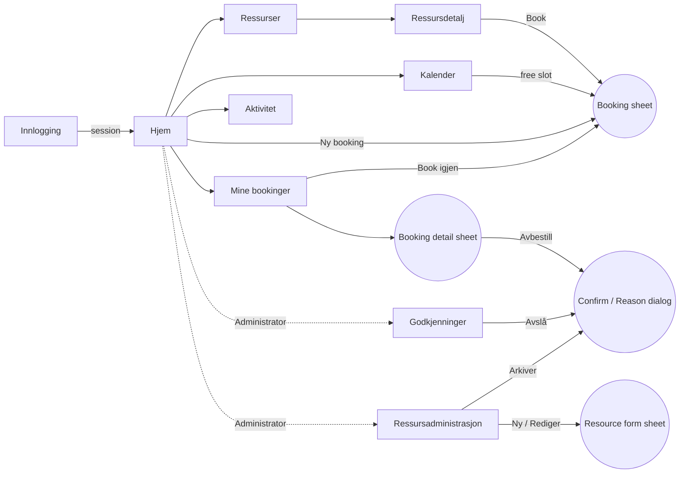
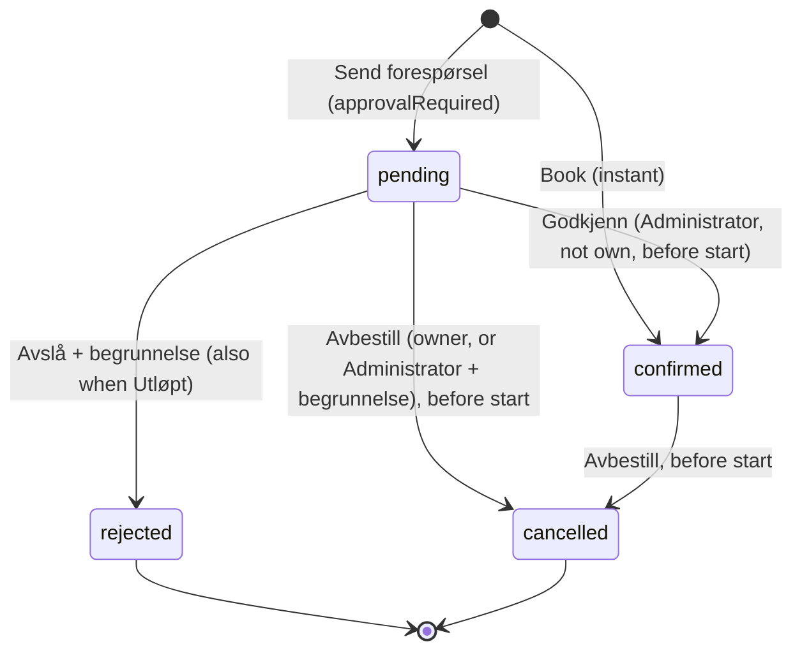

# FELLES — Experience Spine

> How FELLES works. `DESIGN.md` owns how it looks and is referenced here by token name, for example `{colors.primary}`. Requirement IDs (AUT, RES, BOK, APP, VIS, UI, BR) and journey names (UJ-1…UJ-4) are those of the sources. Mocks under `mockups/` illustrate; the two spines are the contract and win on any conflict. Named overlays are capitalised (Booking sheet, Booking detail sheet, Resource form sheet, Mer sheet, Reason dialog, Confirm dialog); generic components are lowercase in running text.

## Foundation

Single responsive web app, served locally. Tested targets are 375px (phone) and 1440px (desktop); the layout must not scroll horizontally at either (UI-2). Two roles, Member and Administrator, with role-based navigation. The server enforces every rule the UI reflects (AUT-03), so the UI's job is to make the allowed action obvious and the refused one understandable.

UI system: a small custom component set built on CSS custom properties (spec §6: CSS variables, Tailwind optional, no external UI service). `DESIGN.md` is the token source. Whether behaviour primitives (dialog focus trapping, grid and listbox semantics) come from a headless library or are hand-written is an architecture decision. All visible text is Norwegian bokmål with nb-NO date, time and number formatting (UI-5); `lang="nb"` on the document.

Times are shown in Europe/Oslo. A booking starts and ends on a 30-minute grid between 08:00 and 22:00 local time, lasts 30 minutes to 4 hours, and can start any time from now until 30 days ahead (BOK-02). The UI never shows a time it cannot book.

## Information Architecture

Eight surfaces (UI-1). "Reached from" lists the navigation and the in-product entry points.

| Surface | Route | Who | Reached from | Purpose |
|---|---|---|---|---|
| Innlogging | `/logg-inn` | anyone without a session | app open, session expiry, "Logg ut" | Email and password sign-in (AUT-01) |
| Hjem | `/` | all | nav, wordmark, after sign-in | Upcoming own bookings, resources, "Ny booking"; Administrators also get the 7-day panel and chart (VIS-03, VIS-04, VIS-06) |
| Ressurser | `/ressurser` | all | nav, Hjem resource grid | Search and filter active resources (RES-01) |
| Ressursdetalj | `/ressurser/:id` | all | Ressurser card, booking rows, activity links | Resource facts, today's availability, "Book" (RES-01) |
| Kalender | `/kalender?ressurs=&uke=` | all | nav, Ressursdetalj "Se i kalender", Booking detail sheet | Week view per resource, navigate weeks, book from a free slot (VIS-01) |
| Mine bookinger | `/mine-bookinger` | all | nav, toast after booking, Hjem list | Own bookings, upcoming first; detail, cancel, rebook (VIS-02, BOK-06, BOK-08) |
| Godkjenninger | `/godkjenninger` | Administrator | nav (count), Hjem pending stat | Queue of pending requests; approve or reject (APP-01…04) |
| Ressursadministrasjon | `/ressursadministrasjon` | Administrator | nav | All resources including archived; create, edit, archive (RES-03, RES-04) |
| Aktivitet | `/aktivitet` | all (scoped) | nav, Booking detail sheet "Historikk" | Audit timeline (VIS-05) |

Overlays, not routes: the **Booking sheet** (create a booking), the **Booking detail sheet** (one booking, opened by `?booking=` so it survives refresh and can be linked), the **Resource form sheet** (Administrator), the **Reason dialog** (reject, or Administrator cancels another's booking), the **Confirm dialog** (cancel own, archive) and the **Mer sheet** (mobile navigation overflow). Overlays stack at most one dialog on top of one sheet (for example, confirm a cancellation from inside the Booking detail sheet); never deeper.

Navigation. Desktop sidebar: Hjem, Ressurser, Kalender, Mine bookinger, Aktivitet; Administrators also see a section "Administrasjon" with Godkjenninger (approvable count pill) and Ressursadministrasjon. Mobile tab bar: Hjem · Ressurser · Kalender · Bookinger (= Mine bookinger) · Mer; the Mer sheet lists Aktivitet, the Administrator pages, the user block and Logg ut. ARIA and the Mer button's behaviour are in Component Patterns → App shell.

Role visibility: Administrator-only surfaces are absent from a Member's navigation; if a Member opens one by URL, it renders the "Ingen tilgang" state (the server returns 403; the UI never pretends the page is empty).

→ `mockups/index.html` links all eight surfaces at 1440px and 375px.

## Voice and Tone

Microcopy rules; brand posture lives in `DESIGN.md` → Brand & Style. The product speaks plain bokmål to a colleague: short, concrete, no exclamation marks, no emoji, no words from the data model ("pending" is "Venter").

| Do | Don't |
|---|---|
| "Bookingen er bekreftet." | "Suksess! Din booking ble opprettet" |
| "Tidsrommet er ikke lenger ledig. Velg et annet tidspunkt." | "Konflikt (409)" |
| "Feil e-post eller passord." | "Brukeren finnes ikke" (AUT-01 forbids revealing which) |
| "Du kan ikke behandle din egen forespørsel." | Hiding the row or greying it out without a reason |
| "Ingen kommende bookinger." + "Finn en ressurs" | "Her var det tomt 😊" |
| "Avbestille bookingen?" with resource and time in the body | "Er du sikker?" |
| Buttons are verbs: Book, Send forespørsel, Godkjenn, Avslå, Avbestill booking, Arkiver, Lagre, Behold | "OK", "Ja", "Submit" |

Formats (the one home for these rules):
- Dates: "i dag" and "i morgen" when true, otherwise the nb-NO short form "man. 19. okt."; long form "mandag 19. oktober" where there is room (Date field caption, sheet headers).
- Times: "10:00–11:00" with an en dash; 24-hour clock.
- Durations: visible text "1 t 30 min"; accessible names and live-region text use whole words ("1 time 30 minutter", "mandag 19. oktober, klokken 10:00, ledig", "sendt for 2 timer siden"). No abbreviation is ever read aloud.
- Attribution lines: "Avslått av Sofie Lund · fre. 16. okt. 11:20" (middle dot separator).
- Error messages name what happened and what to do next, in that order.

Status vocabulary, used identically in badges, filters, toasts and activity text: **Bekreftet** (`confirmed`), **Venter** (`pending`; long form "Venter på godkjenning" in the Booking detail sheet), **Avslått** (`rejected`), **Avbestilt** (`cancelled`), **Utløpt** (an expired request: still `pending` in the database, start has passed, CR-3), **Arkivert** (an archived resource). Anonymous blocks in the calendar are **Reservert** (CR-2).

## Component Patterns

Behaviour. Visual specs are in `DESIGN.md` → Components under the same names. Four patterns with keyboard models have their own subsections after the table.

| Component | Where | Behavioural rules |
|---|---|---|
| App shell (Sidebar, Icon rail, Top bar, Tab bar) | every authenticated surface | Shows the signed-in name and role (AUT-04). Session is checked once on load; while it resolves the shell renders with skeleton content, never a blank screen. "Logg ut" ends the session, closes any open overlay and routes to Innlogging. Nav items are links; the current surface's link carries `aria-current="page"` wherever that link lives (sidebar, tab bar or Mer sheet) and a non-colour cue (bar and weight, see `DESIGN.md`). "Mer" is a `<button aria-haspopup="dialog" aria-expanded>` that opens the Mer sheet; its count dot reads "3 ventende godkjenninger"; when the current page lives under Mer, the Mer tab also shows the active style. |
| Button | everywhere | One primary per view region. Buttons disabled by state (own request in the queue, archived resource) keep their label and state the reason in visible text beside them. In-flight behaviour is in Form below. |
| Form (validation and submission) | every form: Innlogging, Booking sheet, Resource form sheet, Reason dialog | See the Form subsection below. |
| Input / Select / Textarea | forms | Label always visible (no placeholder as label). Optional fields say "(valgfritt)" in the label (Antall plasser, Beskrivelse); all others carry `required` and `aria-required`. Textareas for purpose and reasons have no `maxlength`; see Form for the counter rule. |
| Date field | Booking sheet | Native date input, `min` today, `max` today + 30 days (BOK-02). Changing it reloads the slot picker for that day and clears any selection. The caption beneath restates the day in words. Prefilled from the context that opened the sheet: a calendar cell supplies the date and start; "Book igjen" supplies resource and purpose but not the date. |
| Search field | Ressurser | Filters the loaded list client-side as you type (RES-01; lists are small); matches name, description and location; Escape clears. |
| Chip (filter) | Ressurser, Ressursadministrasjon | Single-select group (Alle / Rom / Utstyr; Aktive / Arkiverte) with `aria-pressed`. State is reflected in the URL query so a refresh keeps it. |
| Segmented control | Hjem chart | Diagram / Tabell; remembers the choice per browser. |
| Switch | Resource form sheet ("Krever godkjenning") | `role="switch"`; the label states the consequence: "Nye bookinger må godkjennes av en administrator" (DEC-15: existing bookings unaffected). |
| Symbol picker / Colour picker | Resource form sheet | Radio groups (`role="radiogroup"`) over the fixed lists in `DESIGN.md` → Resource symbols and colours; arrow keys move, one tab stop each; options are named in Norwegian ("Mikrofon", "Blå"), never by the stored code; the selected value is also stated in text beside the group ("Valgt: Blå") so the choice is not colour-only. |
| Badge | lists, details, calendar legend | Text plus dot always; **Utløpt** replaces **Venter** when the request's start is in the past. Never interactive. |
| Resource card | Ressurser, Hjem | The whole card is one link to Ressursdetalj. Shows "Krever godkjenning" when set (RES-05). Archived resources never appear here (RES-04). |
| List row | Mine bookinger, Hjem, Godkjenninger | Tapping the row opens the Booking detail sheet. Inline actions on booking rows: "Avbestill" only when status is Venter or Bekreftet and start is in the future (BOK-06); "Book igjen" when the booking is past or in a final status (BOK-08). Actions are real buttons, reachable by Tab, never hover-only. |
| Table | Ressursadministrasjon, desktop | Row actions "Rediger" and "Arkiver"; archived rows show the Arkivert badge and no actions. Becomes stacked cards below 768px. |
| Availability strip | Ressursdetalj | Read-only picture of today for this resource, 08:00–22:00 in 30-minute segments; segments expose "Ledig, klokken 10:00 til 10:30" / "Reservert, …" / "Din booking, …" as accessible names. Not interactive; "Book" and "Se i kalender" are the actions. |
| Week strip | Kalender, mobile | A `tablist` of seven day chips; arrow keys move; the chosen day loads the single-day timeline, which is the calendar grid with one column and the same cell names. Previous and next move whole weeks; swiping is not required. |
| Calendar block | Kalender | Own bookings show purpose and time; others show "Reservert" and time (CR-2); Administrators see booker and purpose on all blocks. Pending blocks are dashed; expired requests remain shown as pending until resolved (they still block). |
| Popover | Kalender | Opens on click or Enter on another Member's block as a non-modal `role="dialog"` anchored to the block; contains "Reservert", the time, and nothing else (CR-2); Escape or clicking outside closes it; focus returns to the block. |
| Tooltip | icon-only controls | Shown on hover and focus, hidden on Escape; `role="tooltip"` referenced by `aria-describedby`; never the only way to learn a control's name (the control has an `aria-label` too). |
| Sheet | Booking sheet, Booking detail sheet, Resource form sheet, Mer sheet | Opens from the right on desktop (full-screen on mobile) as a modal `role="dialog"` with focus moved to its title; Escape or the close button closes; focus returns to the trigger. Unsaved changes in a form sheet prompt "Forkaste endringene?" before closing. The body scrolls; the footer stays (scroll padding in Accessibility Floor). |
| Dialog (Confirm, Reason) | cancel, reject, archive | Modal, focus-trapped, labelled by its title. The destructive button is on the right (desktop) or on top (mobile, stacked) and is never pre-focused; initial focus is the first field when a reason is required, otherwise the safe action ("Behold" / "Avbryt"). Escape cancels. |
| Reason dialog | Avslå; Administrator cancels another's booking | Textarea "Begrunnelse", required, 1–200 characters (DEC-14), with the hint "Begrunnelsen vises til {name}". Submit is `aria-disabled` until the field has text; over 200 characters follows the Form rule. The reason is shown to the booking owner in the Booking detail sheet and in Aktivitet (APP-04, DEC-07). |
| Toast | after successful mutations | One at a time; `role="status"`. A plain toast lasts 4 seconds and pauses on hover or focus. A toast that carries a link ("Vis i Mine bookinger") or a button stays until the user dismisses it with its "Lukk" button or navigates away, so keyboard users can reach the action (WCAG 2.2.1). Errors are not toasts; they render inline where the action happened. |
| Alert (inline) | forms, pages | Error alerts carry a "Prøv igjen" button when a retry makes sense (network, 5xx). Conflict and state errors (409) carry the next step instead ("Velg et annet tidspunkt"). Focus target rules are in Form. |
| Empty state | lists, queues, search | One sentence and one action that leads to the nearest way of changing the situation. |
| Skeleton | every list and panel on first load | Mirrors the final layout. Shown after 150ms so fast responses never flash. Replaced in place; no layout jump. |
| Timeline | Aktivitet, Booking detail sheet | Each entry: actor, verb, entity link, time (VIS-05). Entity links open the Booking detail sheet or Ressursdetalj. Members see only events on their own bookings; Administrators see all, including resource changes (DEC-03). |
| Bar chart | Hjem (Administrator) | Stacked confirmed/pending per day for the next seven days (VIS-06). The "Tabell" alternative is a real table with the same numbers; the chart carries `role="img"` with an `aria-label` summary. No animation on load. |
| Demo pill | shell | Static marker "Demo" with `title="Syntetiske demodata"`; tells the user the data is seeded (spec §1). |

### Form (validation and submission)

The single home for how every form behaves.

- **Behaviour.** Validate on blur and on submit; clear an error as soon as its value becomes valid. Field errors render under the field; when a submit produces more than two errors, they are also listed once at the top of the form. Submit is `aria-disabled` only while a required free-text field (purpose, reason) is empty, and the field's hint says what is needed. Any other invalid state, including more than 200 characters, keeps submit enabled and is refused with the field error, so the user reads a message rather than meeting a dead button. The server is the final judge; its field errors render exactly like client ones.
- **Counters.** A visible counter ("17/200") updates on every keystroke. It is announced politely only when the length crosses 180 or 200 characters. Past 200 characters the field shows the error "Maks 200 tegn." with its icon (DEC-14).
- **In flight.** The submit button takes `aria-disabled="true"` (never the `disabled` attribute, which would drop focus) and shows a spinner with its label unchanged; repeat activations are ignored; the form's inputs become read-only.
- **Outcome and focus.** On success, focus follows the closing overlay's rule (back to the trigger). On a server error, the inline alert renders directly above the submit button and receives focus (`tabindex="-1"`); it is announced with `aria-live="assertive"`. Field errors are tied to their fields with `aria-describedby`.

### Slot picker

Shows availability for the chosen resource and date as 28 half-hour slots from 08:00 to 22:00 (BOK-07).

- **Behaviour.** Taken slots (any `pending` or `confirmed` booking) and slots in the past are disabled. Selection is start, then end; the end slot's 30 minutes are included. Activating 10:00 alone selects the 30-minute booking 10:00–10:30 (the BOK-02 minimum); activating 10:30 next extends it to 10:00–11:00; activating a later free slot moves the end; activating the start slot again clears everything. The picker refuses an end that crosses a taken slot, exceeds 4 hours, or precedes the start, and says why under the grid in `body-sm` with an icon.
- **Keyboard.** `role="grid"` with one roving tab stop (`tabindex="0"` on the focused cell); arrow keys move; Space or Enter selects; cells are `gridcell` buttons in chronological DOM order, so a screen reader can also browse them linearly.
- **Accessible names.** Cells are named with whole words: "klokken 10:00, ledig", "klokken 09:00, opptatt", "klokken 08:00, passert". The visible summary "Valgt: 10:00–11:00, 1 t" is mirrored as "Valgt: 10:00 til 11:00, 1 time" in an `aria-live="polite"` region; refusal messages use the same region.
- **Edge cases.** A date with no free slot disables every slot and shows "Ingen ledige tider denne dagen. Velg en annen dato." After a 409 the picker reloads and clears the selection but keeps the purpose text.

### Calendar (week grid)

One resource at a time (select in the toolbar; default = last viewed, else the first room). Previous / "I dag" / next move whole weeks; the week and resource live in the URL.

- **Behaviour.** Clicking an empty future cell opens the Booking sheet prefilled with resource, date and start = that half hour. Clicking a block opens the Booking detail sheet (own block, or any block for Administrators) or the Popover (another Member's block). Past days are shown but not bookable (`aria-disabled` cells, disabled styling).
- **Keyboard.** The body is a `role="grid"` whose rows are the 28 half-hours and whose columns are the seven days; one roving tab stop; arrow keys move by cell; Home and End jump to 08:00 and 21:30; PageUp and PageDown change week; Enter on a free future cell opens the Booking sheet, Enter on a block opens its detail or popover.
- **Accessible names.** Cells: "mandag 19. oktober, klokken 10:00, ledig" / "…, Reservert" / "…, Din booking: Kundemøte Nordlys" / "…, passert". Blocks: "Reservert, klokken 10:00 til 11:00".
- **Linear alternative.** A "Ledige tider" button beneath the grid expands one heading per day and, under it, that day's free ranges ("09:30–13:00") as buttons that open the Booking sheet prefilled with that start; "Ingen ledige tider" when a day is full.

### Booking detail sheet

Opened from Mine bookinger rows, Hjem rows, calendar blocks (own, or any for Administrators), toast links and Aktivitet entity links; URL `?booking=`.

- **Behaviour.** Shows one booking: resource, long-form status, time, duration, purpose, location, and for Administrators the booker. A "Begrunnelse" card appears when the booking was rejected or cancelled by an Administrator (APP-04, DEC-07). Expired requests add the line "Forespørselen ble ikke behandlet før starttidspunktet." above the reason. "Historikk" lists the booking's Activity Events. Footer actions follow the List row rules (Avbestill when allowed, Book igjen when past or final).
- **Keyboard.** Standard Sheet rules.
- **Edge cases.** Actions reflect the latest server state; if the booking changed since the list loaded (approved, rejected, cancelled by an Administrator) the sheet shows the new status with an info alert "Statusen er oppdatert." 404: "Fant ikke bookingen." with "Til Mine bookinger". 403 (a Member opening another's booking by URL): "Ingen tilgang" inside the sheet.

## State Patterns

Every surface handles cold-load, empty, error and denied states; forms add disabled, submitting, conflict and success (UI-4). The first row holds the defaults; surface rows list only what differs. Mocked states are marked in `mockups/index.html`; the rest are built from this table.

| Surface | Loading | Empty | Request failed / refused | Notes |
|---|---|---|---|---|
| Defaults (every surface unless a row overrides) | Skeleton mirroring the layout, after 150ms | Empty state component | Network or 5xx: inline alert with "Prøv igjen"; the last good data stays visible. 401 (session expired): route to Innlogging with "Økten er utløpt. Logg inn på nytt." 403: "Ingen tilgang" page with "Til Hjem". 404 route: "Fant ikke siden." Offline: top alert "Ingen nettforbindelse"; mutations are disabled until the connection returns | No optimistic updates for bookings; the server is the truth |
| Innlogging | Button spinner on submit | – | "Feil e-post eller passord." inline above the button, both fields marked; never says which was wrong (AUT-01) | After five failures in a row the button waits 10 seconds with a countdown (DEC-11, SHOULD) |
| Hjem | Skeleton greeting, three list rows, three stat tiles | "Ingen kommende bookinger." → "Finn en ressurs". A stat of "0 venter" is normal, not empty | Alert per panel; other panels still render | Pending count excludes expired requests; a second line reads "+ 1 utløpt" when any exist (CR-3) |
| Ressurser | Six skeleton cards | No match: "Ingen ressurser matcher «projektor»." → "Nullstill søk". No active resources at all (only an Administrator can cause this): "Ingen aktive ressurser." → "Opprett ressurs" for Administrators | default | Filter and query live in the URL |
| Ressursdetalj | Skeleton header and strip | "Ingen ledige tider i dag." with "Se i kalender" | 404: "Fant ikke ressursen." → "Til ressurser". Archived: the page renders read-only with the Arkivert badge and no "Book" button | "Book" opens the Booking sheet with the resource fixed |
| Kalender | Grid lines without blocks | A week with no bookings is a normal grid; no empty message. No resource selected (first visit): a "Velg en ressurs" prompt renders in place of the grid | default; the last good week stays visible | Past days visible but not bookable |
| Mine bookinger | Four skeleton rows | "Ingen kommende bookinger." → "Finn en ressurs"; the "Tidligere" section is hidden when empty | default | Rows with Utløpt carry the explanation in the Booking detail sheet |
| Godkjenninger | Three skeleton rows | "Ingen ventende forespørsler." (no action needed) | Processing an already-handled row: inline alert "Forespørselen er allerede behandlet." and the row is removed on refresh (APP-03) | Own request: actions disabled with the text "Du kan ikke behandle din egen forespørsel." (APP-02). Expired: Utløpt badge, only "Avslå" shown (CR-3) |
| Ressursadministrasjon | Skeleton table | Archived filter with none: "Ingen arkiverte ressurser." | Archive refused (409): alert "Ressursen har 2 fremtidige bookinger og kan ikke arkiveres." with a link "Se bookinger" (RES-04). Field errors inline (RES-03) | Archived rows have no actions; unarchiving is out of scope |
| Aktivitet | Six skeleton timeline items | "Ingen aktivitet ennå." | default | "Vis flere" appends the next batch (DEC-16) |
| Booking sheet | Slot picker skeleton while availability loads | Date with no free slot: see Slot picker | 409 conflict: inline alert "Tidsrommet er ikke lenger ledig. Velg et annet tidspunkt." and the picker reloads (BOK-07). 400: per-field errors. Resource archived meanwhile: alert "Ressursen er ikke lenger tilgjengelig." with the submit disabled by state | Submit label is "Book" for instant resources and "Send forespørsel" when approval is required (BOK-05); the success toast differs accordingly |
| Booking detail sheet | Skeleton of the key–value list | – | See the Booking detail sheet subsection | – |

Confirmation before destructive actions (UI-4): cancelling a booking, rejecting a request and archiving a resource each require a dialog; approving does not (it is the expected positive action and the queue shows the result at once).

## Interaction Primitives

- **Pointer and touch.** Click or tap to act. Whole cards and rows are single targets; secondary actions inside rows are separate buttons with their own targets. No drag anywhere (WCAG 2.5.7). No hover-only affordances; hover only adds emphasis.
- **Keyboard.** Tab order follows reading order. Enter activates links and buttons; Space toggles switches and chips; arrow keys move inside the slot picker, the calendar grid, the week strip and the pickers; Escape closes the topmost overlay. A "Hopp til innhold" skip link is the first focusable element.
- **Forms.** Enter in a single-line input submits the form. Everything else is in Component Patterns → Form.
- **Navigation state in the URL.** Resource, week, filters, query and the open booking live in the query string so refresh and the Back button work (AUT-04 also requires the session to survive refresh).
- **Feedback timing (the one home for these numbers).** Plain toasts 4 seconds; toasts with an action persist until dismissed. Skeletons after 150ms. Sheets, dialogs and popovers animate 180ms ease-out; hover and press transitions 120ms. With `prefers-reduced-motion` everything appears instantly and skeletons do not shimmer.
- **Banned.** Infinite scroll, pagination controls (lists use "Vis flere"), auto-refresh that moves content under the pointer, modal stacks deeper than sheet plus dialog, confirmation for non-destructive actions, browser `alert()` and `confirm()`.

## Accessibility Floor

Target WCAG 2.2 AA (UI-3). Visual contrast is specified and verified in `DESIGN.md` → Colors; control sizing is in `DESIGN.md` → Layout & Spacing; component-level ARIA is with each component above. This section holds the cross-cutting rules and the test bar.

- **Structure.** One `h1` per surface, landmarks (`header`, `nav` with `aria-label`, `main`), `lang="nb"`, document title "FELLES – " followed by the page name. Skip link to `main`.
- **Focus.** Visible 2px ring on every focusable element (`{components.focus-ring}`, `{colors.focus-ring-on-dark}` on the toast); nothing removes outlines. Overlays trap focus and return it to the opener. Focus is never dropped: in-flight buttons use `aria-disabled` and server errors move focus to the inline alert (Form). Sticky bars never cover the focused element (2.4.11): the mobile scroll root sets `scroll-padding-top: 56px` and `scroll-padding-bottom: 64px`; sheet bodies set `scroll-padding-bottom` to the footer height.
- **Forms.** Every control has a programmatic label; the required convention is "(valgfritt)" on optional labels and `aria-required` on the rest (Input row). Errors are identified by text and icon, never colour alone. Redundant entry is avoided: "Book igjen" prefills resource and purpose (3.3.7). Sign-in is a plain email and password form with no puzzle (3.3.8); the password field has a 40×40 "Vis" toggle.
- **Names and language.** Accessible names and live-region text use whole words (Voice and Tone → Formats); nothing read by assistive technology says "t" or "man.". Stored English values (status codes, symbol ids, colour ids) never reach the UI or its accessible names.
- **Status and dynamic content.** Toasts use `role="status"`; slot selection and availability changes announce politely; the pending count pill has an accessible name "Godkjenninger, 3 venter".
- **Grids.** Both ARIA grids (Slot picker, Calendar) have a roving tab stop, whole-word cell names and a linear path (chronological DOM order; the "Ledige tider" list).
- **Motion.** All transitions respect `prefers-reduced-motion`. No autoplaying or looping animation.
- **Chart.** The bar chart has a text alternative (the Tabell view) and an `aria-label` summary; pending bars are dashed, so colour is not the only differentiator.
- **Testing bar for S07.** Axe clean on all eight surfaces at 375 and 1440; the E2E-10 keyboard walk at 375px: sign in, find a resource, book, cancel, read an error, with no horizontal scroll; a screen-reader pass of the Slot picker, the Calendar grid and the Booking detail sheet.

## Responsive & Platform

Dimensions live in `DESIGN.md` → Layout & Spacing; this table holds the behavioural changes per band.

| Breakpoint | Shell | Behaviour |
|---|---|---|
| ≥ 1024px (target 1440) | Sidebar | Two-column Hjem and Ressursdetalj; three-column resource grid; full week grid; sheets dock to the right |
| 768–1023px | Icon rail | Single-column Hjem; two-column resource grid; the week grid keeps seven columns with blocks showing time only |
| < 768px (target 375) | Top bar + tab bar | Everything single column; tables become cards; the calendar becomes week strip plus day timeline; sheets go full-screen; dialogs stay centred cards with stacked buttons; action rows wrap and every control is 40px; the primary action of a page ("Ny booking", "Ny ressurs") sits in the page header, not a floating button |

Browser support: current Chromium, Firefox and Safari on macOS and Windows; iOS Safari and Android Chrome for the 375px target. No native app.

## Key Flows

Personas are the PRD's: Ingrid Haugen (Member), Magnus Berg and Sofie Lund (Administrators), Jonas Dahl (Member). Today is Monday 19 October 2026. The booking lifecycle every flow walks through:

### Flow 0 — Sign in and land

Ingrid, Monday 09:08, new browser. → `mockups/key-innlogging.html`.

1. Ingrid opens FELLES. There is no session, so Innlogging renders with focus in "E-post".
2. She types her address and a mistyped password and presses Enter. The button spins, then the form shows "Feil e-post eller passord." above the button; both fields are outlined; focus moves to the message. Nothing reveals which part was wrong (AUT-01).
3. She corrects the password and submits.
4. **Climax:** Hjem renders with "Hei, Ingrid" and her role in the sidebar. A refresh keeps her signed in (AUT-04).

- **Variant, session expiry:** twelve hours later she opens the Booking sheet and presses Book; the server answers 401; the sheet closes, Innlogging renders with the info alert "Økten er utløpt. Logg inn på nytt.", and after signing in she lands on Hjem (no deep-link restore in v1).
- **Variant, sign-out:** "Logg ut" closes any overlay without a prompt and shows Innlogging with the note "Du er logget ut."

### Flow 1 — Book an instant room (UJ-1)

Ingrid, Monday 09:10, needs Fjellet at 10. → `mockups/key-ressurser.html`, `mockups/key-kalender.html` (Booking sheet at rest and in conflict).

1. Ingrid opens FELLES; the session is live, Hjem renders: "Hei, Ingrid", no upcoming bookings yet, the resource grid below.
2. She taps **Ressurser**, filters **Rom**, and opens **Fjellet** (8 plasser, 2. etasje, no approval badge).
3. Ressursdetalj shows today's availability strip: 09:00–09:30 taken (Reservert), the rest free. She presses **Book**.
4. The Booking sheet opens with Fjellet fixed and the Date field on today. The slot picker shows 08:00–09:00 as past and 09:00 as taken, 09:30 onward free. She taps 10:00 (summary: "Valgt: 10:00–10:30, 30 min"), then 10:30; the range highlights and the summary reads "Valgt: 10:00–11:00, 1 t".
5. She types the purpose "Kundemøte Nordlys" (17/200) and presses **Book**. The button spins; the sheet's inputs become read-only.
6. **Climax:** the sheet closes, focus returns to "Book", a toast says "Bookingen er bekreftet." with a link "Vis i Mine bookinger" and a "Lukk" button, and the availability strip behind it already shows 10:00–11:00 as "Din booking". Nothing else moved. She knows the room is hers without opening anything else (E2E-01).

- **Variant, from the calendar (UJ-1 wording):** from Ressursdetalj she presses "Se i kalender"; Kalender opens on Fjellet, this week; she clicks the empty 10:00 cell on Monday (or arrows to it and presses Enter); the Booking sheet opens with resource, date and start prefilled, and steps 5–6 follow. The new block appears in the grid as her own confirmed booking.
- **Failure, conflict (E2E-02/03):** Jonas booked 10:00–10:30 two seconds earlier. The server answers 409; the sheet stays open with the inline alert "Tidsrommet er ikke lenger ledig. Velg et annet tidspunkt.", focus on the alert; the picker reloads and 10:00 is now struck through; her purpose text is kept.
- **Failure, validation:** she picks 10:00 then 14:30; the picker refuses the end and explains "Maks 4 timer." under the grid; nothing is sent.

### Flow 2 — Request approval-gated equipment (UJ-2, part 1)

Ingrid, Monday, planning Wednesday's podcast. → `mockups/key-kalender.html` (Booking sheet), `mockups/key-mine-bookinger.html`.

1. From Mine bookinger, Ingrid presses **Ny booking** in the page header.
2. The Booking sheet opens with a resource select first. She picks **Podkast-sett**; a note appears under the select: "Krever godkjenning. Forespørselen må godkjennes av en administrator før den er bekreftet."
3. She changes the Date field to ons. 21. okt. (the picker reloads for that day), selects 13:00 then 14:30 for 13:00–15:00, and types the purpose "Episode 12". The submit button reads **Send forespørsel**.
4. **Climax:** toast "Forespørselen er sendt til godkjenning." Mine bookinger lists the row with the **Venter** badge at the top of "Kommende". The calendar, if she looks, shows the slot as her dashed pending block, and for everyone else it is already Reservert (BOK-05).

### Flow 3 — Approve a request (UJ-2, part 2)

Magnus, Wednesday 09:05. → `mockups/key-dashboard.html`, `mockups/key-godkjenninger.html` (queue, Reason dialog, toast after approval).

1. Magnus opens Hjem. The Administrator panel reads "Ventende godkjenninger 3" with "+ 1 utløpt" beneath; the sidebar pill on Godkjenninger also says 3.
2. He opens **Godkjenninger**. Rows sorted by start time: Jonas's expired Lysgården request first with an **Utløpt** badge and only **Avslå**; Ingrid's Podkast-sett request; Jonas's Lysgården workshop; and Magnus's own Kamera request with both buttons disabled and the text "Du kan ikke behandle din egen forespørsel."
3. He reads Ingrid's row (resource, requester, "ons. 21. okt. 13:00–15:00", "Episode 12", "Sendt for 2 t siden") and presses **Godkjenn**.
4. **Climax:** the row shows a spinner for a moment, then leaves the list with a toast "Forespørselen er godkjent."; the count pill drops to 2. Ingrid's Mine bookinger row now reads **Bekreftet**, and the activity log records "Magnus Berg godkjente booking B-1047" with the time (APP-02, E2E-04). The slot was blocked the whole time.

- **Failure, double processing (APP-03):** Sofie approved the same request a second earlier. Magnus's click returns 409; the row shows an inline alert "Forespørselen er allerede behandlet." and disappears on the next refresh.
- **Failure, own request (E2E-09):** the buttons are disabled in the UI; if the API is called directly the server refuses, and the UI shows "Du kan ikke behandle din egen forespørsel." as an inline alert.

### Flow 4 — Reject a request with a reason (UJ-2, alternative)

Sofie, Friday 11:20; the camera is at the repair shop. → `mockups/key-godkjenninger.html` (Reason dialog), `mockups/key-mine-bookinger.html` (Booking detail sheet with the reason).

1. Sofie opens Godkjenninger and finds Ingrid's Kamera Sony A7 request for Friday.
2. She presses **Avslå**. The Reason dialog opens with focus in "Begrunnelse"; the button **Avslå forespørsel** is `aria-disabled` until she types.
3. She writes "Kameraet er på service denne uken." (34/200) and confirms.
4. **Climax:** toast "Forespørselen er avslått.", the row leaves the queue, and the slot is free again at once (APP-04). Ingrid's row shows **Avslått**; opening it reveals "Avslått av Sofie Lund · fre. 16. okt. 11:20" and the reason verbatim (E2E-05).

- **Variant, expired request (CR-3):** the request's start has passed. The row shows **Utløpt** and only **Avslå** is offered; the same dialog applies, and the Member's Booking detail sheet reads "Forespørselen ble ikke behandlet før starttidspunktet." above the reason.

### Flow 5 — Cancel an upcoming booking (UJ-4)

Ingrid, change of plans. → `mockups/key-mine-bookinger.html` (list, Confirm dialog, Booking detail sheet).

1. In Mine bookinger, Ingrid presses **Avbestill** on tomorrow's Skogen row.
2. The Confirm dialog reads "Avbestille bookingen?" with "Skogen · tir. 20. okt. 14:00–15:00" in the body and the buttons **Behold** (focused) and **Avbestill booking** (danger).
3. She confirms.
4. **Climax:** toast "Bookingen er avbestilt."; the row moves to "Tidligere" with the **Avbestilt** badge and a **Book igjen** action; the calendar slot is free (E2E-06). History is kept: the row and its activity entries remain.

- **Variant, Administrator cancels another Member's booking (BOK-06, DEC-07):** Magnus opens Jonas's booking from the calendar and presses **Avbestill**; the Reason dialog appears instead of the Confirm dialog; the reason is stored and shown to Jonas in his Booking detail sheet.
- **Guard:** a booking whose start has passed shows no Avbestill at all; only **Book igjen**.

### Flow 6 — Keep the house in order (UJ-3)

Magnus creates and archives resources. → `mockups/key-ressursadministrasjon.html` (table with refused archive, Resource form sheet with field error, archived filter).

1. Magnus opens **Ressursadministrasjon** and presses **Ny ressurs**. The Resource form sheet opens: Navn, Type (Rom / Utstyr), Beskrivelse (valgfritt), Plassering, Antall plasser (valgfritt), Symbol, Farge, and the switch "Krever godkjenning".
2. He submits with an empty name; the field shows "Navn er påkrevd." and focus moves to it (RES-03). He fixes it and saves. Toast "Ressursen er opprettet."; the table gains the row; the catalogue shows it to everyone.
3. He presses **Arkiver** on Fjorden, which has a confirmed booking tomorrow. The Confirm dialog explains what archiving means; he confirms.
4. The server refuses (RES-04): the dialog closes and an inline alert on the row reads "Ressursen har 1 fremtidig booking og kan ikke arkiveres." with a link "Se bookinger" to the calendar.
5. **Climax:** he archives "Gammel projektor" instead; the confirmation succeeds, the row shows **Arkivert**, and the resource vanishes from Ressurser and from every Booking sheet select, while its past bookings stay visible in history and activity (E2E-08).

## Architecture handoff

UX decisions are closed (approved by Jo on 2026-10-19; recorded in `.memlog.md`). These items need a technical confirmation in the architecture step; the UX default stands until changed.

1. **Typeface delivery** — Inter self-hosted through npm (for example `@fontsource/inter`) so no network request is made at runtime; fallback stack as in `DESIGN.md`. Confirm against the offline demo constraint (NFR-01).
2. **Behaviour primitives** — dialog and sheet focus trapping, `role="grid"` roving tab stops, radiogroups and the popover: headless library (for example Radix or React Aria) or hand-written. The spines specify behaviour only.
3. **Date field** — native `<input type="date">` with `min`/`max`; confirm acceptable rendering in the supported browsers, otherwise the week strip becomes the fallback picker.
4. **Sign-in throttling** — the 10-second wait with countdown after five failures depends on DEC-11's SHOULD; if not built, drop that State Patterns row.
5. **Booking detail by URL** — `?booking=` on the current route opens the Booking detail sheet; the API needs a single-booking read with the role-scoped fields (booker and purpose for owner and Administrators).
6. **Availability payload** — the slot picker and availability strip need taken ranges per resource per day; the week grid needs a week's blocks per resource with the anonymised shape for other Members (CR-2).
7. **Activity scope** — Members' Aktivitet and the Booking detail sheet's "Historikk" need events filtered to the viewer's own bookings (DEC-03).
